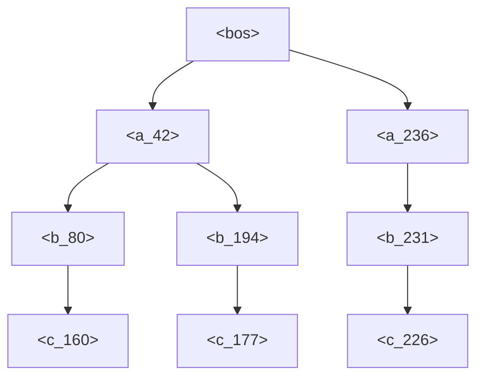
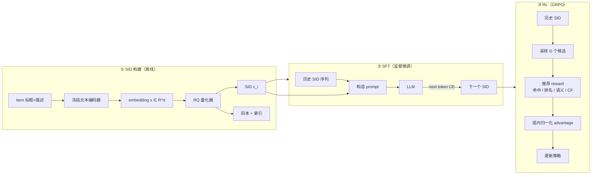

# 01 · 生成式推荐范式与 MiniOneRec 全貌

| | |
|---|---|
| **读这篇前** | 无（只需要知道什么是"序列推荐"） |
| **读完能回答** | 生成式推荐在生成什么？为什么 item 要变成分层 SID？SFT/RL 各解决什么问题？ |
| **对应源码** | 无（全仓库视角，不逐行读代码） |
| **预计耗时** | 30 分钟 |

> 这一章是地图，不涉及代码细节。看完应该能用自己的话解释三阶段流水线。

## 1. 从"打分排序"到"逐 token 生成"

传统推荐（矩阵分解、SASRec、BERT4Rec）做的是：

$$
\text{score}(u, i) = f(\mathbf{h}_u, \mathbf{e}_i), \qquad
\hat{i} = \arg\max_{i \in \mathcal{I}} \text{score}(u, i)
$$

其中 $\mathbf{e}_i$ 通常是**随机初始化、端到端学出来的 ID embedding**。
这带来两个结构性限制：

1. 新 item 没有交互就没有可用的 embedding（冷启动）；
2. item 的语义（标题、描述、类目）只能通过额外特征"外挂"进来。

生成式推荐换了一个问题形式：先把 item 映射成一段**离散 token 序列**（Semantic ID, SID），
再让语言模型在 token 空间里做自回归生成：

$$
p(i \mid \mathcal{H}_u) \approx p(c_i \mid c_{h_1}, \dots, c_{h_T})
= \prod_{l=1}^{L} p\!\left(c_i^{(l)} \mid c_i^{(<l)}, c_{h_1}, \dots, c_{h_T}\right)
$$

其中 $c_i = (c_i^{(1)}, \dots, c_i^{(L)})$ 是 item $i$ 的 SID，$\mathcal{H}_u$ 是用户历史。
**推荐任务被改写成了语言建模任务**，于是可以直接复用预训练 LLM 的参数、tokenizer 和训练框架。

---

## 2. SID 是什么，为什么是分层的

MiniOneRec 的 SID 长这样：

```text
item 0: <a_236><b_231><c_226>
item 1: <a_42><b_80><c_160>
item 2: <a_42><b_194><c_177>
```

- 三个位置分别叫第 1/2/3 层（level）；
- 每层的取值来自一个大小 $K=256$ 的码本；
- **相同前缀 = 语义相近**。item 1 和 item 2 共享 `<a_42>`，说明它们在量化空间的第一层属于同一簇。

为什么必须分层？因为这样生成本质上是一棵 **前缀树（trie）**：



这带来两个直接好处：

1. **合法性可保证**：解码时每一层只允许走"存在完整 item 路径"的分支，
   不会生成一个不存在的 item（见 [06-evaluation.md](./06-evaluation.md)）；
2. **搜索空间指数级缩小**：$256^3 \approx 1.68 \times 10^7$ 种组合，但真实 item 只有几千到几万个
   （仓库自带样例为 3,686 个），前缀树把无效分支全部剪掉。

> 注意：SID 不是"哈希"。哈希只保证唯一性，不保证语义；
> SID 是**语义量化**的结果，前缀相近意味着文本 embedding 相近。

---

## 3. 三阶段流水线

MiniOneRec 把整个系统拆成三个可以独立调试的阶段：



### 3.1 SID 构建：把语义压成离散码

1. 把 item 的 `title` 和 `description` 拼成一句话；
2. 用**冻结**的文本编码器（论文默认 Qwen2.5-3B）取最后一层 hidden state，做 masked mean pooling；
3. 用残差量化（RQ-VAE 或 RQ-KMeans）把 $d$ 维向量压成 $L$ 个整数码；
4. 把整数码映射成 token：`<a_{c1}><b_{c2}><c_{c3}>`。

细节见 [03-sid-construction.md](./03-sid-construction.md)。

### 3.2 SFT：让 LLM 学会"续写 SID"

训练样本的核心形式是：

```text
### Instruction:
Can you predict the next possible item that the user may expect?

### User Input:
The user has interacted with items <a_12><b_7><c_3>, <a_9><b_201><c_44> in chronological order.
Can you predict the next possible item that the user may expect?

### Response:
<a_42><b_80><c_160>
```

损失只在 `### Response:` 之后计算（prompt 部分 label 置 `-100`）。
但 MiniOneRec 不只训这一个任务，还混入了三类**语言对齐任务**：

| 任务 | 输入 | 输出 | 目的 |
|---|---|---|---|
| 序列推荐 | 历史 SID 序列 | 下一个 SID | 主任务 |
| SID → 标题 | `What is the title of item "<a_..><b_..><c_..>"?` | 标题文本 | 让 SID 与语义绑定 |
| 标题 → SID | `Which item has the title: ...?` | SID | 反向绑定 |
| 历史 SID → 标题 | 历史 SID 序列 | 目标标题 | 用自然语言监督序列偏好 |

这样做的直觉：**如果模型只知道 SID 之间的共现，它学到的只是一个 ID 序列模型；
加上 SID↔文本的双向对齐，才能把 LLM 的语义知识真正"接"到推荐空间里。**

细节见 [04-sft.md](./04-sft.md)。

### 3.3 RL：用推荐指标继续优化

SFT 的交叉熵只关心"下一个 token 对不对"，不直接优化 HR/NDCG。
RL 阶段对每个 prompt 采样 $G$ 个候选 SID，用推荐 reward 打分，
再做组内归一化：

$$
A_i = \frac{r_i - \operatorname{mean}(r_1,\dots,r_G)}
{\operatorname{std}(r_1,\dots,r_G) + \epsilon}
$$

然后最大化 $A_i \log \pi_\theta(c_i \mid \text{prompt})$，并加 KL 约束防止偏离参考策略。
细节见 [05-rl.md](./05-rl.md)。

---

## 4. 和传统推荐代码的对应关系

读 MiniOneRec 时，可以把传统模块这样"翻译"过来：

| 传统推荐里的概念 | MiniOneRec 里的对应物 | 代码位置 |
|---|---|---|
| item embedding table | SID token embedding（新加的词表行） | `sft.py:TokenExtender` |
| user history encoder | LLM 的 causal self-attention | `AutoModelForCausalLM` |
| next-item softmax | LM head 在 SID token 上的分布 | `outputs.logits` |
| top-K 召回 | constrained beam search | `LogitProcessor.py` |
| 训练样本 (u, history, target) | `(prompt, completion)` | `data.py` 各 Dataset |
| 评估 HR@K / NDCG@K | 生成 K 个 SID 后按顺序算 | `calc.py` |

---

## 5. 这套范式的代价（读论文时容易忽略）

1. **量化误差**：SID 是 $d$ 维向量的有损压缩，重建误差会变成推荐误差的上限；
2. **冲突（collision）**：两个不同 item 可能量化到同一个 SID，必须去重；
3. **生成长度**：一个 item 需要 $L$ 个 token，$L$ 越大表达力越强但推理越慢；
4. **约束解码依赖索引**：新增 item 必须重建前缀树，否则永远生成不到；
5. **RL 的 reward 是代理指标**：rule/NDCG reward 与线上收益并不等价。

这些代价在源码里都有对应的工程处理，后面几篇会逐一指出。

---

## 6. 自检问题

读完本篇，应该能回答：

1. 为什么 SID 的第一层可以粗粒度、最后一层必须细粒度？
2. 如果两个 item 的 SID 完全相同，会发生什么？源码怎么处理？
3. SFT 为什么要混入 `sid2title` / `title2sid`，而不是只训序列推荐？
4. RL 阶段为什么不直接从原始 LLM 开始，而要从 SFT checkpoint 开始？
5. 约束 beam search 保证的是"item 合法"还是"item 正确"？

带着这些问题进入 [02-data-pipeline.md](./02-data-pipeline.md)。
