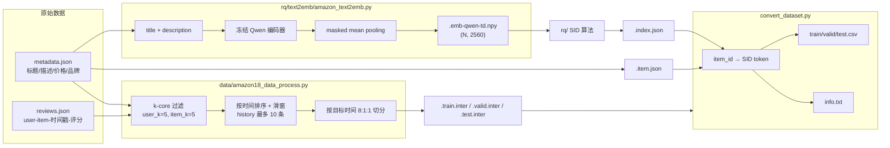

# 02 · 数据管线：从 Amazon 原始数据到训练 CSV

本篇只关心一件事：**一行训练样本是怎么来的，每个字段的下标到底指向谁。**
这是读 MiniOneRec 最容易出错的地方——`.npy`、`.item.json`、`.index.json`、`.inter`
四份文件里的 "item id" 并不总是同一个东西。

---

## 1. 总览



---

## 2. 第一阶段：Amazon 原始数据 → `.inter`

入口：`data/amazon18_data_process.py`，shell 包装在 `data/amazon18_data_process.sh`。

### 2.1 关键步骤

1. **加载 metadata / reviews**
   - `load_metadata_json2csv_style()`：只保留有 `title` 的 item；
   - `load_reviews_json2csv_style()`：按时间范围过滤。

2. **k-core 过滤**（`k_core_filtering_json2csv_style`）
   - 反复删除交互数 < `user_k` 的用户、被交互数 < `item_k` 的 item，直到稳定。
   - 这是推荐系统标准操作，目的是去掉长尾噪声，让 SID 码本学到更稳定的语义。

3. **生成交互序列**（`generate_interaction_list_json2csv_style`）
   - 每个用户按 `unixReviewTime` 排序；
   - 对第 `i` 个物品，历史是 `items[max(i-10, 0):i]`，即**最多 10 条**；
   - 每条样本是一个"预测第 i 个物品"的样本。

4. **按目标时间切分**（`convert_to_atomic_files_json2csv_style`）
   - 所有样本按 target timestamp 排序；
   - 前 80% → train，接下来 10% → valid，最后 10% → test。
   - **不是按用户切分**，而是按全局时间切分；同一用户可能同时出现在三个 split。

### 2.2 输出格式

`data/Amazon18/<dataset>/<dataset>.train.inter`：

```text
user_id:token	item_id_list:token_seq	item_id:token
0	12 45 78 3	99
0	45 78 3 99	120
...
```

- 第一列：用户索引（0-based）；
- 第二列：历史 item 的**数值索引**（不是 ASIN）；
- 第三列：目标 item 的数值索引。

> `token_seq` 只是 RecBole 风格的字段名，内容是空格分隔的整数。

GPR 版本多一列 `e_token`（模拟场景 token）：

```text
user_id:token	item_id_list:token_seq	item_id:token	e_token:token
0	12 45 78 3	99	[CTX_SEARCH]
```

---

## 3. 第二阶段：item 文本 → embedding

入口：`rq/text2emb/amazon_text2emb.py`，shell 包装 `rq/text2emb/amazon_text2emb.sh`。

### 3.1 文本怎么拼

`generate_text(item2feature, ['title', 'description'])`：

```python
text = title + ' ' + description   # 实际实现会对 description 做清洗/截断
```

论文与代码默认使用 **title + description**，而不是只用 title。

### 3.2 编码与池化

```python
outputs = model(input_ids=..., attention_mask=...)
last_hidden = outputs.last_hidden_state        # (B, T, d)
mask_expanded = attention_mask.unsqueeze(-1).expand_as(last_hidden).float()
sum_embeddings = (last_hidden * mask_expanded).sum(dim=1)   # (B, d)
sum_mask = mask_expanded.sum(dim=1).clamp(min=1e-9)          # (B, 1)
mean_output = sum_embeddings / sum_mask                      # (B, d)
```

- `d` 由编码器决定：Qwen2.5-3B 是 2560，Qwen2.5-1.5B 是 1536；
- 多卡用 `accelerate` 按 item 数均分，主进程 `gather_object` 后按原顺序排序再 `np.stack`；
- 输出：`<dataset>.emb-qwen-td.npy`，形状 `(N_items, d)`，**行号就是 item 的数值索引**。

### 3.3 一个容易忽略的对齐约束

```text
.npy 的第 i 行
  ↔ .item.json 的 key "i"
  ↔ .index.json 的 key "i"
  ↔ .inter 里的 item_id = i
```

`amazon18_data_process.py` 用 `item2index` 把 ASIN 映射成 0..N-1，
`generate_indices.py` 直接 `enumerate(all_indices)` 生成 key，
二者依赖**同一个 item 顺序**。如果你自己换了预处理脚本，务必保证这三份文件的行序一致，
否则 SID 会整体错位，且不会报错。

---

## 4. 第三阶段：`.inter` + `.index.json` → 训练 CSV

入口：`convert_dataset.py`。

### 4.1 读取的三份输入

| 文件 | 内容 |
|---|---|
| `<dataset>.item.json` | `{item_id: {title, description, brand, ...}}` |
| `<dataset>.index.json` | `{item_id: ["<a_..>", "<b_..>", "<c_..>"]}` |
| `<dataset>.{train,valid,test}.inter` | 交互序列 |

### 4.2 核心映射（`convert_interactions_to_csv`）

```python
# 历史 item id -> SID 字符串
history_semantic_ids = []
for item_id in history_item_ids:
    semantic_tokens = item_to_semantic[str(item_id)]
    semantic_id = ''.join(semantic_tokens)      # ["<a_42>","<b_80>"] -> "<a_42><b_80>"
    history_semantic_ids.append(semantic_id)

# 目标 item 同理
```

注意 `semantic_tokens_to_id` 是**直接拼接**，不保留空格：

```text
["<a_42>", "<b_80>", "<c_160>"]  →  "<a_42><b_80><c_160>"
```

### 4.3 输出的 CSV 字段

`data/Amazon/train/Industrial_and_Scientific_5_2016-10-2018-11.csv`：

| 列 | 类型 | 含义 |
|---|---|---|
| `user_id` | str | 原始用户 id 加前缀 `A` |
| `history_item_title` | str(list) | 历史标题，CSV 里存成 `['title1', 'title2']` |
| `item_title` | str | 目标标题 |
| `history_item_id` | str(list) | 历史数值 id，`[12, 45, 78]` |
| `item_id` | int | 目标数值 id |
| `history_item_sid` | str(list) | 历史 SID，`['<a_..><b_..><c_..>', ...]` |
| `item_sid` | str | 目标 SID |
| `user_id_original_str` | str | **仅 GPR**，原始用户 id |
| `e_token` | str | **仅 GPR**，场景 token |

> CSV 里的 list 是 Python 字面量字符串，`data.py` 用 `eval()` 还原。
> 只应加载可信数据；不要在生产环境直接对用户上传的 CSV 调用 `eval()`。

### 4.4 info 文件

`convert_dataset.py:create_item_info_file` 生成：

```text
<a_236><b_231><c_226>	SUPCO SPP6 Relay/Capacitor Hard Start Kit ...	0
<a_42><b_80><c_160>	Stanley TRA708T Sharpshooter ...	1
```

三列：`SID \t title \t item_id`。

它同时被三处使用：

- `evaluate.py`：构建 SID → item 的约束前缀树；
- `calc.py`：判断预测是否落在合法 item 集合、并算命中；
- `rl.py`：构建 `item2id`，用于语义/CF reward。

---

## 5. 实际文件长什么样（仓库自带数据）

```text
data/Amazon/
├── index/
│   ├── Industrial_and_Scientific.index.json    # {item_id: ["<a_..>", ...]}
│   ├── Industrial_and_Scientific.item.json     # {item_id: {title, description, ...}}
│   └── Industrial_and_Scientific.emb-qwen-td.npy
├── info/
│   └── Industrial_and_Scientific_5_2016-10-2018-11.txt
├── train/
│   └── Industrial_and_Scientific_5_2016-10-2018-11.csv
├── valid/
└── test/
```

一条真实样本（截断）：

```text
user_id: A...
history_item_title: ['SUPCO SPP6 ...', 'Stanley ...']
item_title: '...'
history_item_id: [1024, 233]
item_id: 88
history_item_sid: ['<a_12><b_7><c_3>', '<a_9><b_201><c_44>']
item_sid: '<a_42><b_80><c_160>'
```

---

## 6. 不装依赖也能做的检查（CPU）

仓库根目录执行，只用标准库：

```bash
python3 - <<'PY'
import json, csv

idx = json.load(open('data/Amazon/index/Industrial_and_Scientific.index.json'))
item = json.load(open('data/Amazon/index/Industrial_and_Scientific.item.json'))
print('items in index:', len(idx))
print('first:', next(iter(idx.items())))

with open('data/Amazon/train/Industrial_and_Scientific_5_2016-10-2018-11.csv',
          newline='', encoding='utf-8') as f:
    row = next(csv.DictReader(f))
print('columns:', list(row))
print('item_sid:', row['item_sid'])
print('history_item_id:', row['history_item_id'])
PY
```

重点确认三件事：

1. `index` 和 `item` 的 key 集合是否一致；
2. `item_sid` 的层数是否等于 `--num_emb_list` 的长度；
3. `history_item_sid` 里的每个 SID 是否都能在 `index` 的值里找到。

---

## 7. 常见坑

| 现象 | 原因 | 排查 |
|---|---|---|
| SID 全部错位 | `.npy` / `.item.json` / `.index.json` 行序不一致 | 用上面的脚本比对 key 与 embedding 行数 |
| `KeyError: <sid>` | SID 去重时新增了 token，但 info 文件没重建 | 重新跑 `convert_dataset.py` |
| 训练集只有最后一个样本 | `keep_longest_only=True`（GPR 转换脚本默认） | 检查 `convert_dataset_gpr.py` 的参数 |
| `item_id` 当成了 ASIN | `.inter` 里存的是数值索引 | 看 `amazon18_data_process.py` 的 `item2index` |
| 评估文件列对不上 | `split.py` 用 `index=True` 多写了一个索引列 | 读 CSV 时按列名取，别按位置 |

---

## 8. 下一步

现在 item 已经有文本 embedding 了，下一步是把它压成 SID：
[03-sid-construction.md](./03-sid-construction.md)。
