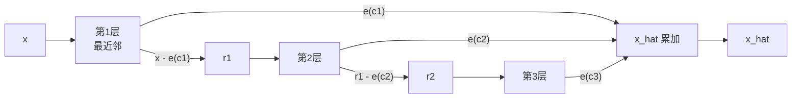

# 03 · SID 构建：RQ-VAE、RQ-KMeans 与冲突处理

> 目标：把 `(N, d)` 的 item 文本 embedding 变成 `(N, L)` 的离散码，
> 再变成 token 字符串 `<a_i><b_j><c_k>`。
>
> 对应源码：`rq/` 目录。

---

## 1. 统一的数学框架：残差量化

设 item embedding 为 $x \in \mathbb{R}^{d}$，码本层数为 $L$，每层码本
$\mathcal{C}^{(l)} = \{e_1^{(l)}, \dots, e_K^{(l)}\}$。

残差量化（Residual Quantization）的定义：

$$
\begin{aligned}
r^{(0)} &= x \\
c^{(l)} &= \arg\min_{k} \left\| r^{(l-1)} - e_k^{(l)} \right\|_2^2 \\
r^{(l)} &= r^{(l-1)} - e_{c^{(l)}}^{(l)} \\
\hat{x} &= \sum_{l=1}^{L} e_{c^{(l)}}^{(l)}
\end{aligned}
$$

- 第 1 层量化"整体语义"，第 2 层量化"第 1 层没解释掉的残差"，以此类推；
- SID 就是 $(c^{(1)}, \dots, c^{(L)})$；
- 重建误差 $\|x - \hat{x}\|^2$ 随 $L$ 增大而减小，但 token 数也线性增加。



`rq/models/rq.py:39` 的 `ResidualVectorQuantizer.forward` 就是这段伪代码：

```python
x_q = 0
residual = x
for quantizer in self.vq_layers:
    x_res, loss, indices = quantizer(residual, use_sk=use_sk)
    residual = residual - x_res
    x_q = x_q + x_res
    all_indices.append(indices)
all_indices = torch.stack(all_indices, dim=-1)   # (B, L)
```

---

## 2. 路线 A：RQ-VAE（可学习）

### 2.1 网络结构

`rq/models/rqvae.py:12`：

```text
encoder: [in_dim, 2048, 1024, 512, 256, 128, 64, e_dim]   # MLP + ReLU
rq:      L × VectorQuantizer(K=256, e_dim=32)
decoder: encoder 的镜像
```

默认超参（`rq/rqvae.py:31-37`）：

| 参数 | 默认值 | 含义 |
|---|---|---|
| `num_emb_list` | `[256, 256, 256]` | 每层码本大小 |
| `e_dim` | 32 | 量化空间维度 |
| `layers` | `[2048,1024,512,256,128,64]` | encoder 隐层 |
| `beta` | 0.25 | commitment loss 权重 |
| `kmeans_init` | `True` | 第一层用 k-means 初始化码本 |
| `sk_epsilons` | `[0,0,0]` | 默认不做 Sinkhorn |

### 2.2 前向与损失

`rq/models/vq.py:66` 的 `VectorQuantizer.forward`：

```python
# 1) 最近邻
d = ||latent||^2 + ||embedding||^2 - 2 * latent @ embedding.T   # (B, K)
indices = argmin(d, dim=-1)

# 2) 量化
x_q = embedding(indices)

# 3) 损失
commitment_loss = MSE(x_q.detach(), x)
codebook_loss   = MSE(x_q, x.detach())
loss = codebook_loss + beta * commitment_loss
```

整体损失（`rq/models/rqvae.py:compute_loss`）：

$$
\mathcal{L} = \underbrace{\|x - \hat{x}\|_2^2}_{\text{重建}}
+ \lambda_q \underbrace{\left( \|x - \mathrm{sg}[\hat{x}]\|_2^2
+ \beta \|\mathrm{sg}[x] - \hat{x}\|_2^2 \right)}_{\text{码本 + commitment}}
$$

其中 $\mathrm{sg}[\cdot]$ 是 stop-gradient。代码里 `quant_loss_weight=1.0`，即 $\lambda_q=1$。

反向传播用 straight-through estimator：

```python
x_q = x + (x_q - x).detach()   # 前向是量化值，反向梯度直接穿过
```

### 2.3 训练与模型选择

`rq/trainer.py:187`：

- 每个 epoch 训练后在**训练集自身**上算 `collision_rate`；
- 同时保存 `best_loss_model.pth` 和 `best_collision_model.pth`；
- **生成 SID 时应使用 `best_collision_model.pth`**，因为推荐系统更怕冲突，而不是更怕重建误差。

```bash
cd rq
python rqvae.py \
  --data_path ../data/Amazon/index/Industrial_and_Scientific.emb-qwen-td.npy \
  --ckpt_dir ./output/Industrial_and_Scientific \
  --lr 1e-3 --epochs 10000 --batch_size 20480
```

### 2.4 Sinkhorn 平衡（可选）

当 `sk_epsilon > 0` 时，最近邻分配会被替换成一次最优传输式的软分配
（`rq/models/layers.py:86`）：

$$
Q = \exp(-d/\epsilon), \qquad
Q \leftarrow \frac{Q}{\sum_i Q_{ij}} \cdot \frac{1}{B}, \qquad
Q \leftarrow \frac{Q}{\sum_j Q_{ij}} \cdot \frac{1}{K}
$$

迭代若干次后取 `argmax`。作用是**防止少数码字被过度使用**（codebook collapse）。
MiniOneRec 只在处理冲突时临时打开它，训练时默认关闭。

---

## 3. 路线 B：RQ-KMeans（免训练）

核心思想：把 VQ 的"可学习码本"换成"对残差做 k-means 得到的聚类中心"。

```text
r = x
for l in 1..L:
    codes[:, l] = KMeans(r, K).labels
    r = r - centroids[codes[:, l]]
```

实现有两份：

| 文件 | 特点 |
|---|---|
| `rq/rqkmeans_faiss.py` | FAISS `ResidualQuantizer`，快；配合 `ot` 做 Sinkhorn 平衡 |
| `rq/rqkmeans_constrained.py` | 每层用 `KMeansConstrained`，强制簇大小均衡 |

### 3.1 constrained RQ-KMeans 的"均衡"到底约束了什么

`rq/rqkmeans_constrained.py:26`：

```python
min_size = max(1, n // K - 1)
max_size = n // K + 1
KMeansConstrained(n_clusters=K, size_min=min_size, size_max=max_size, ...)
```

它保证每个簇的样本数在 $n/K \pm 1$ 附近，避免"一个簇吃掉一半 item、其余码字闲置"。
对推荐的影响：**SID 前缀分布更均匀，beam search 的候选覆盖更稳定**。

```bash
cd rq
python rqkmeans_constrained.py \
  --dataset Industrial_and_Scientific \
  --root ../data/Amazon \
  --k 256 --l 3 --max_iter 100 --seed 42 --verbose
```

输出：

- `<dataset>.codebooks_constrained.npz`（每层聚类中心）
- `<dataset>.codes_constrained.npy`（`(N, L)`，0-based）
- `<dataset>.index.json`（token 字符串）

### 3.2 RQ-KMeans+（残差连接 + 热启动）

`rq/rqkmeans_plus.py:24`：

1. 把 encoder 包一层残差：$z = x + \mathrm{MLP}(x)$；
2. 把 MLP 最后一层 **零初始化**，于是训练开始时 $z = x$，不破坏已有码本；
3. 从 constrained 版本导出的 `.npz` **热启动**码本；
4. 再继续训练 VQ 的 encoder/decoder。

约束：`--e_dim` 必须等于输入维度（默认 2560），否则 `x + MLP(x)` 无法相加。
这也是 `rqkmeans_plus.py:130` 会直接报错退出的原因。

```bash
cd rq
bash rqkmeans_constrained.sh          # 先得到 codebooks_constrained.npz
bash rqkmeans_plus.sh                 # 热启动 + 残差连接继续训练
bash generate_indices_plus.sh         # 导出 .index.json
```

---

## 4. 从整数码到 token

### 4.1 命名规则

`generate_indices.py:88`：

```python
prefix = ["<a_{}>", "<b_{}>", "<c_{}>", "<d_{}>", "<e_{}>"]
```

第 1 层用 `a`，第 2 层 `b`，第 3 层 `c`。所以：

```text
codes = [41, 79, 159]
tokens = ["<a_41>", "<b_79>", "<c_159>"]
SID    = "<a_41><b_79><c_159>"
```

### 4.2 一个关键但容易忽略的差异：0-based vs 1-based

| 路径 | 是否 +1 | 示例 |
|---|---|---|
| `generate_indices.py`（RQ-VAE） | **否** | `<a_0>` … `<a_255>` |
| `rqkmeans_constrained.py` | **是** | `<a_1>` … `<a_256>` |
| `generate_indices_plus.py` | **是** | `<a_1>` … `<a_256>` |

两者都能正常工作，因为 token 只是一组互不相同的符号。
**但同一次实验内必须保持一致**：训练用的 `.index.json`、评估用的 `info.txt`、
RL 用的 `info_file` 必须来自同一次 SID 构建。

### 4.3 去重（deduplication）

不同 item 可能量化到完全相同的 $(c^{(1)}, c^{(2)}, c^{(3)})$，这叫 **collision**。
如果不去重，模型无法区分这些 item，评估时也只能命中其中一个。

`rqkmeans_constrained.py:131` / `generate_indices_plus.py:23` 的处理：

```python
# 对每组重复的 codes，把该组内的序号 rank 追加到最后一层
codes = codes + [rank_within_group]
```

例如三个 item 都是 `<a_42><b_80><c_160>`：

```text
item A -> <a_42><b_80><c_160><d_1>
item B -> <a_42><b_80><c_160><d_2>
item C -> <a_42><b_80><c_160><d_3>
```

实际代码是 `pl.col("codes").list.concat(rank)`，即列表长度从 $L$ 变成 $L+1$。
对于原本 3 层的 SID，去重后会短暂出现 4 个 token；
`data.py` 在构造 prompt 时直接使用 `.index.json` 里的 token 列表，因此不会出错，
但你要知道**去重后的 SID 可能比 `--num_emb_list` 的长度多一层**。

> 这也是为什么源码里多处写 `if len(sids) >= 3: combined_sid = sids[0]+sids[1]+sids[2]`：
> 它们只取前三层做语义对齐，忽略去重附加的 rank。

### 4.4 RQ-VAE 的冲突处理：只对冲突项重新编码

`rq/generate_indices.py:110-135`：

```python
while True:
    if tt >= 20 or check_collision(all_indices_str):
        break
    collision_item_groups = get_collision_item(all_indices_str)
    for collision_items in collision_item_groups:
        d = data[collision_items]
        indices = model.get_indices(d, use_sk=True)   # 打开 Sinkhorn
        ...
    tt += 1
```

思路：对冲突 item 单独打开 Sinkhorn，让它们被"挤"到不同码字上；最多重试 20 轮。
如果 20 轮后仍有冲突，冲突会保留（概率很低），不会报错。

---

## 5. 冲突率与评估指标

代码中的定义（`rq/trainer.py:_valid_epoch`）：

$$
\text{collision rate} = \frac{N - |\{\text{unique SID strings}\}|}{N}
$$

- 理想值 0；
- 它只衡量"是否有两个 item 共享同一个 SID"，不衡量语义质量；
- 重建 MSE 低 ≠ 冲突率低，二者要一起看。

一个经验判断：

| collision rate | 含义 |
|---|---|
| 0 | 所有 item 可区分 |
| < 1e-3 | 少量冲突，通常可接受 |
| > 1e-2 | 码本容量不足或分布太偏，建议增大 K/L 或换 constrained 版本 |

---

## 6. 张量形状速查

| 阶段 | 形状 | 代码 |
|---|---|---|
| 输入 embedding | `(B, d)` | `EmbDataset.__getitem__` |
| encoder 输出 | `(B, e_dim)` | `RQVAE.forward` |
| 每层距离矩阵 | `(B, K)` | `VectorQuantizer.forward` |
| 每层 indices | `(B,)` | 同上 |
| 残差量化 indices | `(B, L)` | `ResidualVectorQuantizer.forward` |
| 全库 codes | `(N, L)` | `generate_indices.py` |
| 全库 embedding | `(N, d)` | `.npy` |
| 码本 | `L × (K, e_dim)` | `get_codebook()` |

---

## 7. 不训练也能做的 CPU 练习

### 7.1 手写一维残差量化

用 1 维数据把公式跑一遍，确认自己理解"残差"：

```python
import numpy as np

x = np.array([[0.1], [0.4], [0.8], [0.9], [2.1], [2.4]])
K, L = 2, 2
r = x.copy()
codes = []
for l in range(L):
    # 一维 k-means（手动指定两个中心）
    centers = np.array([[r.min()], [r.max()]])
    assign = ((r - centers.T) ** 2).argmin(axis=1)
    codes.append(assign)
    r = r - centers[assign]
print(np.stack(codes, axis=1))   # (6, 2)
```

观察：第二层的输入是第一层的残差，而不是原数据。

### 7.2 检查已有 index 的冲突率

```bash
python3 - <<'PY'
import json, collections
idx = json.load(open('data/Amazon/index/Industrial_and_Scientific.index.json'))
sids = [''.join(v) for v in idx.values()]
dup = [k for k, c in collections.Counter(sids).items() if c > 1]
print('items:', len(sids), 'unique:', len(set(sids)), 'dup groups:', len(dup))
PY
```

### 7.3 观察 token 分布

```bash
python3 - <<'PY'
import json, collections
idx = json.load(open('data/Amazon/index/Industrial_and_Scientific.index.json'))
for l in range(3):
    c = collections.Counter(v[l] for v in idx.values())
    print(f'level {l}: {len(c)} unique tokens, '
          f'max usage {c.most_common(1)[0][1]}, min usage {min(c.values())}')
PY
```

如果某一层只有几十个 token 被使用，说明码本严重塌缩，应该考虑 constrained / Sinkhorn。

---

## 8. 常见坑

| 现象 | 原因 | 处理 |
|---|---|---|
| `e_dim must equal input dim` | RQ-KMeans+ 的残差要求维度一致 | `--e_dim 2560`（与编码器 hidden 一致） |
| 码本加载后 loss 不降 | 热启动码本与模型维度/层数不匹配 | 检查 `.npz` 的 `codebook_i` 形状 |
| collision rate 长期不降 | `sk_epsilons` 全 0、K 太小、文本太单一 | 增大 K 或开启 Sinkhorn |
| 训练 prompt 里出现 `<c_257>` | 去重时 rank 超出了 K | 正常现象；但语义对齐代码只取前三层 |
| 评估永远生成同一个 SID | 码本塌缩 / 训练不足 | 看各层 token 使用分布 |

---

## 9. 下一步

SID 有了，接下来把它喂给 LLM：
[04-sft.md](./04-sft.md)。
