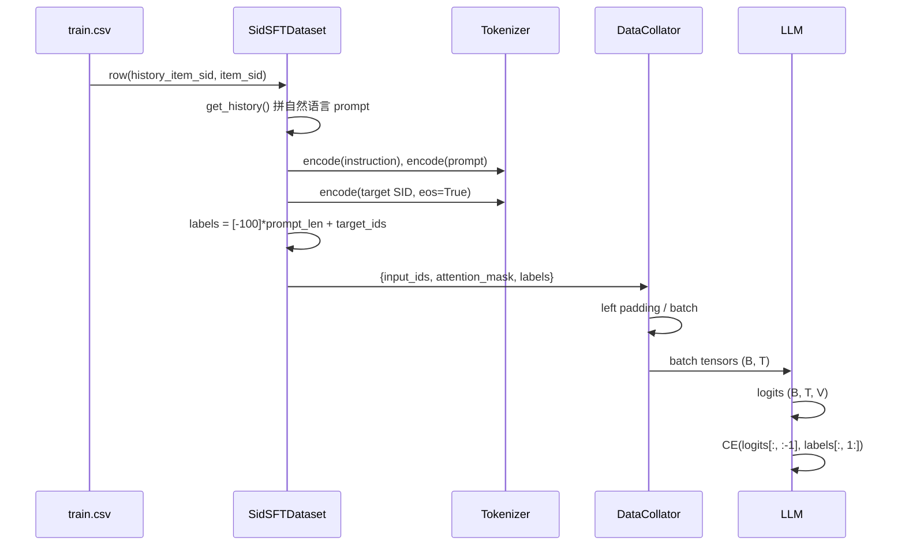

# 04 · SFT：把推荐任务改写为下一个 token 预测

| | |
|---|---|
| **读这篇前** | [03 SID 构建](./03-sid-construction.md)（知道 SID 是几个 token） |
| **读完能回答** | 一条 CSV 样本如何变成 `input_ids / labels`？为什么 `labels` 前面全是 `-100`？新加的 SID token 怎么进词表？ |
| **对应源码** | `sft.py`、`data.py` 中的 SFT 数据集 |
| **预计耗时** | 60 分钟 |

---

## 1. 训练目标

给定用户历史 SID 序列：

$$
h = (c_{i_1}, c_{i_2}, \dots, c_{i_T}), \qquad c_{i_t} = (c_{i_t}^{(1)}, c_{i_t}^{(2)}, c_{i_t}^{(3)})
$$

模型要生成下一个 item 的 SID：

$$
\mathcal{L}_{\text{SFT}} = -\sum_{l=1}^{L}
\log p_\theta\!\left(c_{i_{T+1}}^{(l)} \mid c_{i_{T+1}}^{(<l)}, h, \text{instruction}\right)
$$

注意这不是"预测一个类别"，而是**逐 token 的交叉熵**。
一个 3 层 SID 只有 3 个监督 token（加上换行/EOS 约 5 个），
所以 SFT 阶段每个样本的梯度信号其实很稀疏——这也是后面要混入对齐任务的原因之一。

---

## 2. 一条样本的完整构造过程

以 `SidSFTDataset` 为例（`data.py:397`）。

### 2.1 从 CSV 取字段

```python
row['history_item_sid'] = eval(row['history_item_sid'])
# ['<a_12><b_7><c_3>', '<a_9><b_201><c_44>']

target_item = str(row['item_sid'])      # '<a_42><b_80><c_160>'
```

### 2.2 拼 history 文本

```python
history = "<a_12><b_7><c_3>, <a_9><b_201><c_44>"
input_text = (
    f"The user has interacted with items {history} in chronological order. "
    "Can you predict the next possible item that the user may expect?"
)
```

### 2.3 套模板

`BaseDataset.generate_prompt`（`data.py:80`）：

```text
### User Input: 
{input_text}

### Response:
```

`### Response:\n` 后面留空，因为 target 要单独编码并接到后面。

### 2.4 编码

```python
# instruction 带 BOS
tokens = tokenizer.encode(INSTRUCTION, bos=True, eos=False)

# prompt 不带 BOS
tokens += tokenizer.encode(prompt, bos=False, eos=False)

prompt_len = len(tokens)

# target 不带 BOS、带 EOS
golden = tokenizer.encode(target_item + "\n", bos=False, eos=True)
tokens += golden

labels = [-100] * prompt_len + golden
```

最终序列：

```text
┌──────┬─────────────────────┬──────────────────────────┬───────────────┬─────┐
│ BOS  │ instruction tokens  │ "### User Input: ..."    │ SID tokens    │ EOS │
└──────┴─────────────────────┴──────────────────────────┴───────────────┴─────┘
label:  -100   -100 ... -100        -100 ... -100          <a_42> <b_80> <c_160> \n EOS
        └──────────── 不计算损失 ────────────┘            └──── 计算损失 ────┘
```

- `-100` 是 PyTorch `CrossEntropyLoss(ignore_index=-100)` 的默认忽略值；
- **只有 target SID 及其后的换行/EOS 产生梯度**。

### 2.5 截断

```python
return {
    "input_ids": tokens[-self.max_len:],
    "attention_mask": attention_mask[-self.max_len:],
    "labels": labels[-self.max_len:],
}
```

从**左侧**截断，保留最近的上下文。`sft.sh` 没有显式传 `--cutoff_len`，
所以使用默认值 **512**。如果历史很长，最早的历史 token 会被裁掉；
如果 target 本身超过 512，则 target 也会被截断（极少见）。

---

## 3. 三种 SFT 任务如何混合

`sft.py:186-200` 构造三个 Dataset，然后 `ConcatDataset`：

```python
train_data1 = SidSFTDataset(...)        # 历史 SID -> 下一个 SID
train_data2 = SidItemFeatDataset(...)   # SID <-> 标题
train_data3 = FusionSeqRecDataset(...)  # 历史 SID -> 目标标题
train_data = ConcatDataset([...])
```

| Dataset | 样本数级 | 输入 | 输出 | 作用 |
|---|---|---|---|---|
| `SidSFTDataset` | $N$ | 历史 SID | 下一个 SID | 主推荐任务 |
| `SidItemFeatDataset` | $2N_{\text{item}}$ | SID 或标题 | 标题或 SID | 双向语义对齐 |
| `FusionSeqRecDataset` | $N$ | 历史 SID | 目标标题 | 用自然语言监督序列偏好 |

### 3.1 SID ↔ 标题

`SidItemFeatDataset`（`data.py:678`）从 `.item.json` + `.index.json` 构建：

```python
sid2title[''.join(sids)] = title
title2sid[title] = ''.join(sids)
```

然后为每个 item 生成两条样本：

```text
Q: What is the title of item "<a_42><b_80><c_160>"?
A: Stanley TRA708T Sharpshooter ...

Q: Which item has the title: Stanley TRA708T Sharpshooter ...?
A: <a_42><b_80><c_160>
```

> **版本注意**：旧版本只拼接**前三层**（`sids[0] + sids[1] + sids[2]`），
> 2025-11 之后改成 `''.join(sids)`，**保留全部 token**（包括去重 rank 和新算法追加的身份 token）。
> 如果你的 SID 只有 3 个 token，两种写法完全等价。

### 3.2 历史 SID → 标题

`FusionSeqRecDataset`（`data.py:1126`）：

```text
Q: The user has sequentially interacted with items <a_..>, <a_..>.
   Can you recommend the next item for him? Tell me the title of the item
A: <目标标题>
```

源码里还定义了 `generate_prompt_description`，但 `pre()` 中实际只走 title 分支
（description 分支被注释掉了）。所以 `FusionSeqRecDataset` 当前是"SID 历史 → 标题"。

### 3.3 为什么这样做

只训主任务时，模型可以把 SID 当成纯符号，学一个 ID 转移矩阵；
加入对齐任务后，SID 的隐藏表示必须同时能解码出标题，
等价于把 LLM 预训练得到的语义空间"锚定"到 SID 上。

---

## 4. 新 token 如何进入词表

`sft.py:30` 的 `TokenExtender`：

```python
indices = json.load(index.json)          # {item_id: ["<a_..>", "<b_..>", "<c_..>"]}
new_tokens = sorted({tok for sids in indices.values() for tok in sids})

tokenizer.add_tokens(new_tokens)         # 作为 added tokens，整体一个 token
model.resize_token_embeddings(len(tokenizer))
```

数量级：

$$
|\text{new tokens}| \le L \times K = 3 \times 256 = 768
$$

（去重会额外引入少量 `<d_*>` token。）

关键点：

1. `add_tokens` 添加的是 **special/added token**，不会被 tokenizer 拆成 `<`、`a`、`_`、`42`；
2. 新 token 的 embedding 是随机初始化的，SFT 必须让它们学到东西；
3. `resize_token_embeddings` 同时会调整输入 embedding 和输出 lm_head（如果二者不共享）。

---

## 5. `freeze_LLM=True` 到底冻结了什么

`sft.py:155`：

```python
for param in model.parameters():
    param.requires_grad = False

embedding_layer = model.get_input_embeddings()
embedding_layer.weight.requires_grad = True

def mask_grad(grad):
    grad[:original_vocab_size].zero_()   # 旧词表梯度清零
    return grad

embedding_layer.weight.register_hook(mask_grad)
```

效果：

- 整个 Transformer 冻结；
- 输入 embedding 矩阵可训练，但**只有新增的 SID token 行**会收到非零梯度；
- 旧词表行虽然 `requires_grad=True`，梯度被 hook 清零，等价于冻结。

这个模式适合显存有限、只想学 SID 表示的场景。

> **注意 tied embeddings**：如果模型的输入 embedding 与 lm_head 共享权重
> （`config.tie_word_embeddings=True`），那么输出层也会被这条 hook 影响；
> 如果不共享，lm_head 仍然是冻结的，新增 token 的输出行不会更新。
> 使用 `--freeze_LLM True` 前先确认 base model 的 `tie_word_embeddings`。

---

## 6. 训练循环与超参

`sft.py:222` 使用 HuggingFace `Trainer`：

```python
trainer = transformers.Trainer(
    model=model,
    train_dataset=hf_train_dataset,
    eval_dataset=hf_val_dataset,
    args=transformers.TrainingArguments(
        per_device_train_batch_size=micro_batch_size,
        gradient_accumulation_steps=gradient_accumulation_steps,
        learning_rate=learning_rate,
        bf16=True,
        optim="adamw_torch",
        eval_strategy="steps",
        eval_steps=0.05,
        save_strategy="steps",
        save_steps=0.05,
        save_total_limit=1,
        load_best_model_at_end=True,
        ...
    ),
    data_collator=DataCollatorForSeq2Seq(tokenizer, padding=True),
    callbacks=[EarlyStoppingCallback(patience=3)],
)
```

几个容易误读的点：

| 参数 | 实际含义 |
|---|---|
| `batch_size=1024` | **全局** batch（不是 per-device） |
| `micro_batch_size=16` | 每卡前向 batch |
| `gradient_accumulation_steps` | `1024 // 16 // world_size`；8 卡时为 8 |
| `eval_steps=0.05` | 浮点数表示"总训练步数的 5%"，不是 0.05 步 |
| `save_total_limit=1` | 只保留最近一个 checkpoint；配合 `load_best_model_at_end` 需注意磁盘 |
| `cutoff_len=512` | 默认值；长历史会被左截断 |

`data_collator` 会自动做：

- 左侧 padding（因为 `tokenizer.padding_side = "left"`）；
- `labels` 的 `-100` padding；
- attention mask。

---

## 7. 数据流图



---

## 8. 读源码时要注意的三个细节

### 8.1 去重 SID 与对齐任务的一致性（上游已修）

- 主任务 CSV 的 `item_sid` 可能包含去重附加的 `<d_rank>`；
- **旧版本**：`SidItemFeatDataset` / `RLTitle2SidDataset` 只取前三层
  （`if len(sids) >= 3: sids[0]+sids[1]+sids[2]`）→ 同一个 item 在"序列→SID"任务里目标是 4 个 token，
  在"标题→SID"任务里目标是 3 个 token，模型看到两套冲突的标签；
- **现版本**：统一用 `if sids: ''.join(sids)`，两边都保留全部 token，问题消失。

如果你在旧 commit 上做实验，需要自己把这几处改成 `''.join(sids)`；
在 3-token 数据集上两者行为完全相同，所以这个差异只影响有冲突的数据集。

### 8.2 `negative_prompt_ids` 是死代码

`SidSFTDataset.pre` 里构造了 `negative_prompt_ids`，但后续没有使用。
这是从其他项目继承下来的残留，不影响训练。

### 8.3 未使用的 scheduler

`sft.py` 定义了 `get_cosine_schedule_with_warmup`，但没有传给 `Trainer`
（`optimizers=` 被注释掉）。实际使用的是 `TrainingArguments` 的默认调度器
（线性 warmup + 线性衰减）。读论文时不要误以为用了余弦调度。

---

## 9. CPU 上可以做的验证

不需要 GPU 或模型权重，只要有 `transformers` 和一个任意 tokenizer，
就可以观察 label 构造：

```python
from transformers import AutoTokenizer
from data import SidSFTDataset

tok = AutoTokenizer.from_pretrained("Qwen/Qwen2.5-0.5B")
tok.add_tokens(["<a_42>", "<b_80>", "<c_160>"])
ds = SidSFTDataset(
    train_file="data/Amazon/train/Industrial_and_Scientific_5_2016-10-2018-11.csv",
    tokenizer=tok, max_len=512, category="industrial and scientific items")
sample = ds[0]
print(len(sample["input_ids"]), sample["labels"][-10:])
print(sum(x != -100 for x in sample["labels"]), "supervised tokens")
```

预期：有监督 token 数约为 `SID 层数 + 2`（换行 + EOS）。

---

## 10. 下一步

SFT 只优化"下一个 token 对不对"。要让模型真正排得更好，需要 RL：
[05-rl.md](./05-rl.md)。
