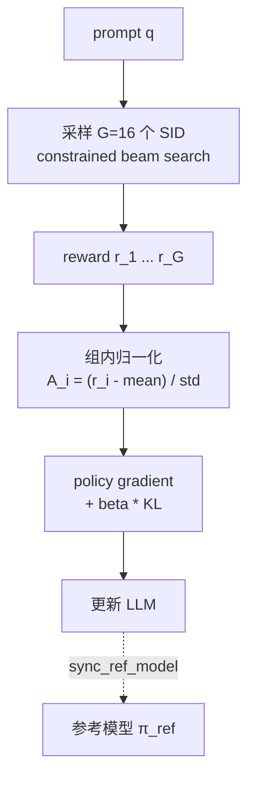
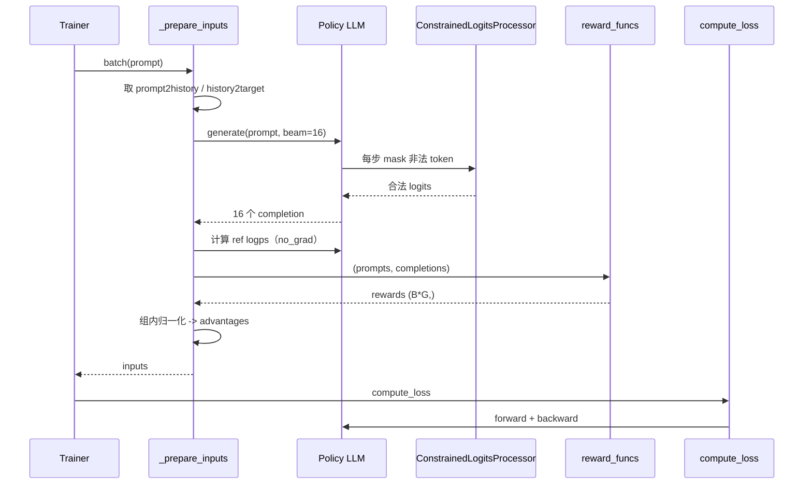

# 05 · 推荐导向的 RL：GRPO + 约束解码 + 推荐 reward

| | |
|---|---|
| **读这篇前** | [04 SFT](./04-sft.md)（知道 prompt/label 怎么来） |
| **读完能回答** | SFT 之后为什么还要 RL？GRPO 的组内归一化怎么做？reward 有几种？约束解码怎么保证只生成合法 SID？ |
| **对应源码** | `rl.py`、`minionerec_trainer.py`、`LogitProcessor.py` |
| **预计耗时** | 120 分钟（建议拆成两次读） |

---

## 1. 为什么 SFT 不够

SFT 的交叉熵只关心"下一个 token 是否等于标注 token"，它有三个问题：

1. **Exposure bias**：训练时看的是真实历史，推理时看的是自己生成的历史；
2. **目标不对齐**：交叉熵不区分"错在第 1 层"和"错在第 3 层"，也不直接优化 HR/NDCG；
3. **没有负样本意识**：模型不需要知道"哪些高分候选是错的"。

RL 阶段把问题改成：

$$
\max_\theta \; \mathbb{E}_{c \sim \pi_\theta(\cdot \mid q)}
\left[ r(c) \right] - \beta \, \mathrm{KL}\!\left(\pi_\theta \,\|\, \pi_{\text{ref}}\right)
$$

- $q$：prompt（历史 SID 或标题）；
- $c$：模型生成的 SID；
- $r(c)$：推荐 reward；
- $\pi_{\text{ref}}$：SFT checkpoint，防止 RL 把语言能力训崩。

---

## 2. GRPO 在推荐场景下的具体形式

GRPO（Group Relative Policy Optimization）不训练 value network，
而是对同一个 prompt 采样 $G$ 个候选，用**组内相对排名**构造 advantage。



### 2.1 组内归一化

`minionerec_trainer.py:963-971`：

```python
rewards = (rewards_per_func * self.reward_weights).sum(dim=1)
mean_grouped = rewards.view(-1, G).mean(dim=1)
std_grouped  = rewards.view(-1, G).std(dim=1)
advantages   = (rewards - mean_grouped.repeat_interleave(G)) \
             / (std_grouped.repeat_interleave(G) + 1e-4)
```

为什么这样做：

- 推荐 reward 的绝对值没有可比性（不同 prompt 难度不同）；
- 减去组内均值后，模型只关心"同一 prompt 下哪个候选更好"；
- 除以标准差让不同 prompt 的梯度尺度接近。

> 如果一组内所有 reward 相同（例如全部没命中），`std=0`，advantage 全为 0，
> 这个 prompt 不产生梯度。`--add_gt` / `--dynamic_sampling` 就是为了缓解这个问题。

### 2.2 损失（默认 GRPO）

`minionerec_trainer.py:1035`：

```python
per_token_logps = self._get_per_token_logps(model, ...)       # (B, C)
ref_per_token_logps = inputs["ref_per_token_logps"]            # (B, C)

per_token_kl = exp(ref - logp) - (ref - logp) - 1              # (B, C)

ratio = exp(logp - logp.detach())                              # 数值上恒为 1
per_token_loss = ratio * advantages.unsqueeze(1) - beta * per_token_kl
loss = ((per_token_loss * completion_mask).sum(1)
        / completion_mask.sum(1)).mean()
```

逐项解释：

- **KL 估计器**：$\exp(\Delta) - \Delta - 1$，其中 $\Delta = \log \pi_{\text{ref}} - \log \pi_\theta$，
  恒非负，是 $D_{KL}$ 的无偏估计（k3 估计器）；
- **ratio**：这里没有 PPO 的 clip，`logp - logp.detach()` 在前向时恒为 0，
  所以 `ratio ≡ 1`；但反向传播时梯度为 $\nabla_\theta \log \pi_\theta$，
  因此这一项就是 policy gradient；
- **mask**：只在 completion token 上算损失，prompt 不参与。

> 阅读提示：TRL 原版 GRPO 有 `epsilon` 裁剪和 `old_per_token_logps`。
> 这份实现**没有** PPO clip，也没有保存 old policy，等价于"单步 on-policy + KL 正则"。

### 2.3 DAPO / GSPO 两个开关

| 开关 | 归一化方式 | 公式 |
|---|---|---|
| 默认 GRPO | 每条序列内部先平均，再对 batch 平均 | $\frac{1}{B}\sum_i \frac{1}{|c_i|}\sum_t \ell_{i,t}$ |
| `--dapo True` | 整个 batch 的所有 token 一起平均 | $\frac{\sum_{i,t}\ell_{i,t}}{\sum_{i,t} m_{i,t}}$ |
| `--gspo True` | 序列级 importance ratio | $\exp\left(\frac{1}{|c_i|}\sum_t \log\frac{\pi_\theta}{\pi_{\text{old}}}\right)$ |

DAPO 解决"长序列被过度加权/短序列被稀释"的问题；
GSPO 把重要性采样从 token 级提升到序列级，降低方差。

---

## 3. 训练数据：三种 prompt

`rl.py:91-113`：

```python
train_data1 = SidDataset(...)              # 历史 SID -> 下一个 SID
train_data2 = RLTitle2SidDataset(...)      # 标题/描述 -> SID
train_data3 = RLSeqTitle2SidDataset(..., sample=10000)  # 标题历史 -> SID
train_data = ConcatDataset([...])
```

| Dataset | prompt | 目标 | 作用 |
|---|---|---|---|
| `SidDataset` | `### User Input: The user has interacted with items <a..>, ...` | 下一个 SID | 主任务 |
| `RLTitle2SidDataset` | `Which item has the title: ...?` | SID | 语义 grounding |
| `RLSeqTitle2SidDataset` | `Given the title sequence ... recommend ...` | SID | 用标题历史泛化 |

每个 Dataset 都维护两个字典（`data.py:381-388`）：

```python
prompt2history[prompt] = history_str
history2target[history_str] = target_sid
```

reward 函数通过 `prompt -> history -> target` 找到标注答案。
**这两个字典的 key 必须与模型看到的 prompt 完全一致**，否则 reward 会 `KeyError`。

#### 数据集里真正进入模型的只有 prompt

虽然每个 Dataset 的 `pre()` 返回 `{"prompt": ..., "completion": ...}`，
但 `completion` **从头到尾没被用过**：

1. `ReReTrainer._set_signature_columns_if_needed`（`minionerec_trainer.py:594`）
   把 signature columns 设成 `["prompt"]`，Trainer 的 `remove_unused_columns=True`
   （默认）会在建 dataloader 时把 `completion` 列直接删掉；
2. `_prepare_inputs` 里也只取 `x["prompt"]`；
3. 标准答案根本不在 batch 里，而是存在上面两个字典中，**只给 reward 用**；
4. `--add_gt` 要塞标准答案时，也是从 `history2target` 里查，不是从数据列里取。

所以 RL 阶段的输入可以概括为：

```text
dataset 行  =  一段 prompt（+ 一个会被丢弃的 completion 占位）
模型        =  对每个 prompt 自己生成 G 条 completion
reward      =  用 prompt → 字典 → 标准答案 去比对
```

这也是为什么 RL 不需要把答案拼在 `labels` 上：GRPO 不靠 teacher forcing 的 token 监督，
只靠"生成完再打分"。

> 副作用：如果两条不同的数据产生了**完全相同的 prompt 文本**，
> 字典的后写入者会覆盖前者，reward 就可能拿错标准答案。
> `RLTitle2SidDataset` 用标题做 prompt，标题重复时会踩到这个坑。
> `SidDataset` 的 prompt 里带完整历史，重复概率低得多。

> 注意：`SidDataset` 的 prompt **没有** SFT 里的 `Below is an instruction ...`
> 前缀，而评估用的 `EvalSidDataset` 有。RL、SFT、评估三处的 prompt 模板并不完全一致。
> 这是研究代码的常见现象；如果你要严格复现，建议统一模板。

---

## 4. 约束 beam search：保证每个候选都是合法 item

### 4.1 为什么需要约束

不加约束时，模型可能生成：

```text
<a_42><b_80><c_999>      # c_999 不存在
<a_42><b_999><c_160>     # 前缀不存在
<a_42>                   # 提前结束
```

这些都不是合法 item，reward 只能给 0，采样效率极低。

### 4.2 前缀树（hash trie）的构建

`minionerec_trainer.py:500-580`（评估里是 `evaluate.py:87`）：

```python
info = ["### Response:\n<a_42><b_80><c_160>\n", ...]
prefixID = [tokenizer(s).input_ids for s in info]

for ID in prefixID:
    ID.append(eos_token_id)
    for i in range(prefix_index, len(ID)):
        key = hash(ID[:i]) if i == prefix_index else hash(ID[prefix_index:i])
        hash_dict[key].add(ID[i])
```

- `prefix_index=3`（非 GPT-2）：对应 `### Response:\n` 的 3 个 token；
- 对每个 SID，把"从 `### Response:\n` 开始的所有前缀"映射到"允许的下一个 token"；
- 最后一个 key 映射到 EOS，保证完整 SID 后可以停止。

注意两组 key 的**形态不同**（这也是源码注释里最容易看错的地方）：

| i | key 的内容 | 例子（token id 用 `-` 连接） |
|---|---|---|
| `i == prefix_index` | 只包含 marker 本身 | `"1053-7264-198"`（= `### Response:\n`） |
| `i > prefix_index` | **只包含已生成的 SID 前缀**，不含 marker | `"17"`（= `<a_42>`）、`"17-908"`（= `<a_42><b_80>`） |

原因是 `else` 分支写的是 `ID[prefix_index:i]`，而不是 `ID[:i]`。
解码时正好对应：

- `count=0` → 取 prompt 最后 3 个 token（marker）→ 命中第一组 key；
- `count>=1` → 只取**已生成**的 token → 命中第二组 key。

如果把第二组 key 想成"marker + SID 前缀"，解码时就永远查不到，vLLM/约束解码会立刻失效。

另外三个细节：

- key 是**token id 用 `-` 拼成的字符串**（`get_hash`），不是可读文本；
- value 先建成 `set`，最后统一转 `list`（顺序无所谓，只用于 mask）；
- 去重产生的第 4 层 `<d_rank>` 会让部分完整 SID 的 key 映射成 `{EOS, <d_x>}`，
  即"3 层就走完"和"再写一层"都合法。

### 4.3 解码时的 mask

`LogitProcessor.py:45`：

```python
scores = log_softmax(scores)
mask = full_like(scores, -inf)

for each beam:
    key = last `count` tokens (count=0 时取最后 3 个)
    allowed = prefix_allowed_tokens_fn(batch_id, key)
    if allowed:
        mask[beam, allowed] = 0
    else:
        mask[beam, eos_token_id] = 0    # 没有合法后继，强制结束

scores = scores + mask
self.count += 1
```

效果：

- 每个 beam 的每一步只在合法 token 上分配概率；
- 生成结果一定是 `.index.json` 里某个 SID 的前缀；
- 到达 EOS 时，一定对应一个完整 item。

> **`count` 是实例状态**：一个 `ConstrainedLogitsProcessor` 只能服务一次连续的 `generate()`。
> 上游把训练用和测试用的处理器拆成了两个实例
> （`test_lp_list` 里的 `ConstrainedLogitsProcessor(num_beams=self.test_beam)`），
> 否则训练/测试交替时会串掉步数，且 beam 数也不一样。自己写新逻辑时不要复用同一个实例。

几个容易写错的措辞（源码注释里也常见）：

| 容易写成 | 准确说法 |
|---|---|
| "模型只会输出 `<a_x>`/`<b_x>`/`<c_x>` 的概率分布" | 模型对**整个词表**（含普通文本 token）都输出分布；约束才把其他 token 压掉 |
| "把 logits 设成 `-inf`" | 实际是先 `log_softmax` 得到对数概率，再对非法位置 `+ (-inf)` ⇒ 概率 0 |
| "第一层只能是 `<a_>`" | 精确说是"该前缀在 trie 里有后继"的 token；第一层的集合来自 `info.txt` 里实际出现过的 `<a_x>` |
| "对整个 prompt 做约束" | 是**逐 beam**：每条 beam 用自己的前缀查自己的合法集 |
| "约束是唯一作用于分数的东西" | `LogitsProcessorList([TemperatureLogitsWarper, ccc])`：先调温度，再做约束 mask |

#### 处理器收到的 `input_ids` 长什么样

HuggingFace 在**每个解码步**调用一次 `logits_processor(input_ids, scores)`，
其中 `input_ids` 是**包含 prompt 在内的完整序列，且 beam 维被展平**：

| 项 | 值 |
|---|---|
| 形状 | `(batch_size × num_beams, cur_len)` |
| `cur_len` | 第 1 次调用 = prompt 长度 `P`；之后每步 +1 |
| dtype / device | `torch.long`，与模型同设备 |
| 行序 | `index = batch_id × num_beams + beam_id` |
| 内容 | 左 padding 后的 prompt + 已生成的 token |

所以代码里才能：

```python
input_ids.view(-1, self._num_beams, input_ids.shape[-1])   # -> (B, G, L)
```

并与 `scores`（`(B×G, V)`）用同一个 `batch_id * num_beams + beam_id` 对齐。

以 `rl.sh` 为例（B=64，G=16，P≈300）：

| 调用次序 | `count` | `input_ids` 形状 | 取的 key | 含义 |
|---|---|---|---|---|
| 第 1 次 | 0 | `(64, P)` | `sent[-3:]` | marker → 所有 `<a_x>` |
| 第 2 次 | 1 | `(64, P+1)` | `sent[-1:]` | `<a_x>` → 合法 `<b_y>` |
| 第 3 次 | 2 | `(64, P+2)` | `sent[-2:]` | `<a_x><b_y>` → 合法 `<c_z>` |
| 第 4 次 | 3 | `(64, P+3)` | `sent[-3:]` | 完整 SID → 只允许 EOS |

（已在本机用同样逻辑模拟验证：`count=3` 时 key 为 `"<a><b><c>"`，allowed=`[EOS]`；
若第三层是不存在的组合，allowed=`[]`，处理器兜底强制写 EOS。）

两个容易踩的前提：

- **`count` 是实例级计数器**，一个 processor 只服务一次 `generate`；
  跨 batch 复用会让 `count` 从中间值开始，key 直接错位；
- `num_beams` 必须与 `generate` 实际用的 beam 数一致（`beam_search=False` 时传 1），
  否则 `view(-1, num_beams, L)` 会报 size 错误或错位。

### 4.4 逐 token 追踪：一次 `generate()` 到底发生了什么

这是最容易误解的地方。**不是"先采样第一层，再重新采样第二层，直到凑够 G 个 SID"**，
而是**一次自回归 beam search，G 条 beam 在同一个循环里并行推进**。
"逐层"只是"逐 token 位置"的另一种说法。

```mermaid
flowchart TB
    P["prompt 末尾：\"### Response:\\n\"<br/>G 条 beam 内容相同"] --> S0
    S0["step 0：mask 后只剩第 1 层 token<br/>从 256 个 &lt;a_x&gt; 中采样/扩展"] --> S0b["得到 G 条 beam，各自带一个 &lt;a_x&gt;"]
    S0b --> S1["step 1：每条 beam 用自己的 &lt;a_x&gt; 查 trie<br/>只在合法的 &lt;b_y&gt; 中采样"]
    S1 --> S2["step 2：用 &lt;a_x&gt;&lt;b_y&gt; 查 trie<br/>只在合法 &lt;c_z&gt; 中采样"]
    S2 --> S3["step 3：完整 SID 后只允许 \"\\n\""]
    S3 --> S4["step 4：只允许 EOS，全部 beam 结束"]
    S4 --> OUT["completion_ids: (B*G, 5)"]
```

具体对应 `minionerec_trainer.py:482`（配置）和 `:700`（调用）：

| 项 | 值 | 说明 |
|---|---|---|
| `num_beams` | `num_generations = 16` | 16 条 beam 并行 |
| `num_return_sequences` | 16 | 全部返回 |
| `do_sample` | `True` | 走 `_beam_sample`（beam search + 采样） |
| `temperature` | 1.0 | 先过 `TemperatureLogitsWarper`，再被约束 mask |
| `max_new_tokens` | 128 | 实际上 5 步左右就 EOS |
| `length_penalty` | 0.0 | 所有候选等长，不起作用 |

每一步的"允许集合"来自 `hash_dict`：

| step | 传给 `prefix_allowed_tokens_fn` 的 key | 允许的 token |
|---|---|---|
| 0 | prompt 最后 3 个 token（`### Response:\n`） | 所有第 1 层 `<a_x>` |
| 1 | `[<a_x>]` | 该分支下合法的 `<b_y>` |
| 2 | `[<a_x>, <b_y>]` | 该分支下合法的 `<c_z>` |
| 3 | `[<a_x>, <b_y>, <c_z>]` | 换行 token |
| 4 | `[…, "\n"]` | 仅 EOS |

所以一条候选的实际 token 序列是：

```text
<a_42> <b_80> <c_160> "\n" <eos>        # 3 个 SID token + 2 个终止 token
```

> 换行符可能和最后一个 SID token 合并成一个 token，具体看 tokenizer；
> 但"完整 SID 之后只允许终止"这一点不变。

### 4.5 "数量"是怎么来的

不是靠循环"生成一个 → 不够再生成"。数量在进模型之前就确定了：

1. `RepeatRandomSampler`（`minionerec_trainer.py:80`）让**每个 prompt 在数据集里连续重复 G 次**；
2. `_prepare_inputs` 里再按 `i % G == 0` 去重（`:780`），只把 `B/G` 个不同 prompt 送进 `generate`；
3. `generate` 一次返回 `B/G × G = B` 条序列，正好与重复后的行数对齐。

以 `rl.sh`（8 卡、`train_batch_size=64`、`G=16`）为例，**每张卡一个 micro-batch**：

| 变量 | 形状 | 数值 |
|---|---|---|
| `prompt_ids`（重复后） | `(B, P)` | `(64, P)` = 4 个 prompt × 16 |
| `dedup_prompt_ids` | `(B/G, P)` | `(4, P)` |
| `generate` 输出 | `(B/G × G, P+C)` | `(64, P+5)` |
| `completion_ids` | `(B, C)` | `(64, 5)` |
| `completion_mask` | `(B, C)` | `(64, 5)`，EOS 之后置 0 |
| `per_token_logps` / `ref_per_token_logps` | `(B, C)` | `(64, 5)` |
| `rewards` | `(B,)` | `(64,)` |
| `advantages` | `(B,)` | `(64,)`，按 4 组 × 16 归一化 |

8 卡合计：每个 micro-step 512 条候选 = 32 个 prompt × 16；
`gradient_accumulation_steps=2`，所以每次参数更新是 1024 条候选 = 64 个 prompt × 16。

#### 为什么"既要重复 16 次，又要再去重"？

这两件事解决的是不同问题，缺一不可：

- **重复 16 次**是**记账**：Trainer 按"行"组织数据，一行最终要对应一条
  `(prompt, completion, reward)`。重复 16 次 = 先占好 16 个候选槽位，
  后面 reward 才能逐行填进去，并按 16 个一组做归一化。
- **去重**是**省算力**：如果直接把这 64 行都丢给 `generate`（每行再看 16 个 beam），
  会得到 64×16 = 1024 条序列，其中大量重复，白烧 16 倍显存和时间。
  所以只取每组的第一行，让 `num_beams=16` 在**一次调用**里补齐这 16 个槽位。

行号对应关系（单卡、B=64、G=16）：

```text
重复后的行：   [0..15]      [16..31]     [32..47]     [48..63]
内容：         P1 ×16       P2 ×16       P3 ×16       P4 ×16
                 │            │            │            │
去重（i%16==0）： 0            16           32           48      → 4 个 prompt
                 │            │            │            │
generate(4 行, num_beams=16) → 每行展开 16 条 beam
                 │            │            │            │
输出：         P1的16个候选  P2的16个候选  P3的16个候选  P4的16个候选
行号：         [0..15]      [16..31]     [32..47]     [48..63]   ← 正好回到原槽位
```

> 当 `--beam_search False` 时不走去重分支：64 行一起进 `generate`，
> 每行独立采样 1 条，最终同样是 64 条候选、同样按 16 个一组对齐。

### 4.6 什么时候才会"多生成再筛"

只有两个**显式**开关（默认都关）：

- `--dynamic_sampling True`：先按 `1.5G` 采样，解码成文本后用 `select_completion`
  优先保留 GT、再按出现频次补足 G 个（`:800-850`）；
- `--add_gt True`：把每组最后一个候选直接替换成标准答案 `prompt + target`
  （`:862-878`），保证组内至少有一个正样本。

除此之外没有 rejection sampling / best-of-n 的重试循环。

### 4.7 训练时是"采样"，评估时是"搜索"

| 维度 | RL 训练 | 离线评估 |
|---|---|---|
| 代码 | `minionerec_trainer.py:482` | `evaluate.py:170` |
| `num_beams` | 16（= G） | 50 |
| `do_sample` | **True**（beam sampling） | **False**（确定性 beam search） |
| 目的 | 要多样性，供组内比较 | 要一个稳定排序，算 HR/NDCG |
| 排序含义 | 仍按 beam score 降序，rank reward 依赖它 | 位置即排名 |
| 是否约束 | 是（同一个 `LogitsProcessor`） | 是 |

#### transformers 4.57 里的 beam sampling 具体怎么抽

`_beam_search(do_sample=True)`（`transformers/generation/utils.py`）每一步做四件事：

1. 16 条 beam 各自对词表打分，非法 token 已被 mask 成 `-inf`；
2. 加上每条 beam 的累计分数，拼成 `(batch, 16 × vocab)` 的矩阵；
3. `softmax` 得到概率，然后 `torch.multinomial(..., num_samples=2×16, replacement=False)`
   **不放回地抽 32 个 `(beam, token)` 组合**；
4. 在这 32 个组合里按累计分数留下最好的 16 条继续，命中 EOS 的转入"已完成"。

关键细节：

- 不是"每条 beam 各自独立抽一个 token"，而是**所有 beam 的所有合法 token 放在一个池子里抽**；
- 也**不是"每条 beam 各抽 2 个"**：32 个是从全局池子里抽的，
  完全可以全部来自同一条 beam（第一个解码步就只有 1 条活跃 beam，32 个全来自它）；
- 抽完不是"每条 beam 取自己概率最大的"，而是**把 32 个候选按累计分数统一排序、留前 16 条**
  作为下一轮的 beam。所以一条 beam 可以分叉成多条子候选，另一条可能一条都没留下；
- 概率不是只看"当前这一步"：分数 = 这条 beam 的历史累计分数 + 当前 token 的 log 概率，
  走得顺的 beam 天然更容易被抽中；只有第一个解码步才是纯看当前 token；
- 抽 `2×num_beams` 是为了留余量：如果抽中的前 16 个里有人写了 EOS，还能凑够 16 条继续写；
- **不放回**抽样 ⇒ 同一步不会重复抽同一个组合；再结合"不同 beam 的前缀本就不同"，
  最终 16 条候选**互不相同**（这也是 README 说"每条 beam 唯一"的由来）；
- 高分 token 不是必中，只是"更容易被抽中"——这就是候选多样性的来源；
- `top_k=None, top_p=None` 时，**约束 mask 是唯一的截断手段**。
  如果不做约束，抽样会在十几万词的整个词表里进行，几乎全是垃圾 token。

#### 用公式写一遍

设当前有 $G$ 条 beam，第 $b$ 条 beam 的合法下一层 token 集合为
$\mathrm{All}(b)$（由它自己的前缀查 trie 得到），则：

$$
\text{候选池大小} = \sum_{b=1}^{G} \bigl|\mathrm{All}(b)\bigr| \le G \times K
$$

实现上张量是 $G \times V$ 的（$V$ 是整个词表），
但非法位置被 mask 成 $-\infty$，权重为 0，所以**有效池子**就是上面的求和。

每个候选 $(b,t)$ 的分数与抽样概率：

$$
s_{b,t} = s_b + \log \pi(t \mid q, \text{prefix}_b),
\qquad
p_{b,t} = \frac{\exp(s_{b,t})}{\sum_{b',t'}\exp(s_{b',t'})}
$$

流程：

```text
① 按 p 不放回抽 2G 个 (beam, token) 组合      → 集合 S
② S 中命中 EOS 的 → 记为"已完成"，不再参与后续
③ S 中其余按 s 排序，取前 G 条 → 下一轮的 running beams
④ 这 G 条的 s 直接成为新的 running_beam_scores
```

两个边界情况：

- 第一个解码步只有 1 条 beam 是活跃的（其余分数 `-1e9`），
  所以池子其实是 $1 \times |\mathrm{All}(0)|$，抽 2G 个第 1 层 token；
- 如果某一步有效候选数少于 $2G$，`torch.multinomial` 会用零概率位置补齐，
  这些位置分数是 $-\infty$，排序时自然排在最后；只要有效候选数 $\ge G$，不影响结果。

> 只有 `--dynamic_sampling` / `--add_gt` 才会在生成之后再做筛选或替换；
> 默认路径没有"重复候选"问题，也没有"生成后去重"的步骤。

#### 那个"分数"到底是什么

一句话：**分数 = 这条候选从 `### Response:\n` 之后到当前 token 的累计对数概率。**

由两段相加而成：

```text
候选分数(beam b, token t)
  = running_score[b]                     ← 这条 beam 已经写出的前缀的累计 log 概率
  + log π(t | prompt + 该 beam 的前缀)    ← 模型对"下一个 token"的打分
```

展开写：

$$
\underbrace{\log P(c^{(1)},\dots,c^{(k-1)}\mid q)}_{\text{running\_score}}
\;+\;
\underbrace{\log P(c^{(k)} \mid q, c^{(1)},\dots,c^{(k-1)})}_{\text{当前 token 的 log 概率}}
=
\log P(c^{(1)},\dots,c^{(k)}\mid q)
$$

也就是说，它其实就是**这条"续写"的联合概率的对数**：

$$
\exp(\text{score}) = P(\text{这个候选前缀}\mid \text{prompt})
$$

**来源拆解（对应代码）**：

1. LLM 前向 → `logits`，形状 `(batch×beams, vocab)`
   （`transformers/generation/utils.py` 的 `_beam_search`）；
2. `log_softmax(logits)` → 每个 token 的 $\log\pi$；
3. `logits_processor`（MiniOneRec 的 `TemperatureLogitsWarper` + `ConstrainedLogitsProcessor`）
   把非法 token 变成 `-inf`，相当于把概率重新归一到合法 token 上；
4. `log_probs + running_beam_scores[:, :, None]` → 得到每个 `(beam, token)` 组合的累计分数；
5. 展平成 `(batch, num_beams × vocab)`，`softmax` 之后就是**抽样概率**。

因此抽样的概率正比于候选的**真实序列概率**：

$$
P_{\text{sample}}(b,t) \propto
\exp\!\big(\text{score}(b,t)\big)
= P(\text{前缀}_b \mid q)\cdot \pi(t \mid q,\text{前缀}_b)
$$

只有当前缀的 beam 明显更"顺"时，它的子候选才会在池子里占更大权重——
这就是为什么用"累计"而不是"只看当前层"。

举个两 beam 的例子（分数为 log 概率，越接近 0 越好）：

```text
beam1  running = -0.51（P(前缀)=0.60）
       + b_80  logπ=-0.36 → 候选分数 -0.87，P=0.42
       + b_194 logπ=-1.20 → 候选分数 -1.71，P=0.18

beam2  running = -2.30（P(前缀)=0.10）
       + b_7   logπ=-0.22 → 候选分数 -2.52，P=0.08
       + b_80  logπ=-1.61 → 候选分数 -3.91，P=0.02
```

归一化后抽样概率约为 `[0.60, 0.26, 0.11, 0.03]`：
beam1 的子候选占绝对优势，尽管 beam2 的 `b_7` 在当前层"单看"概率更高（0.8）。

抽样之后，被选中的 16 条候选把自己的**累计分数**带入下一步，
成为新的 `running_beam_scores`；`length_penalty` 只在最终收敛比较已完成序列时使用，
MiniOneRec 的候选都等长，因此实际不起作用。

> 别把它和 RL loss 里的 `per_token_logps` 混淆：
> beam score 只用于**生成阶段选候选、排序**；
> loss 里的 log 概率是把生成结果重新喂给模型（teacher forcing）另算一遍的。

> `count` 是 processor 实例内的全局步数。评估时每个 batch 新建一个 processor；
> 训练时每次 `_prepare_inputs` 新建一个。不要跨 batch 复用。

#### 一句话记忆（修正版）

> 在当前 16 条 beam 的基础上，每条 beam 按自己的前缀查出各自的合法下一层 token 集；
> 把「前缀 + 候选 token」拼成候选，用「前缀累计对数概率 + 当前 token 的对数概率」
> 作为该候选的分数；把所有 beam 的候选放进**同一个池子**，按概率**不放回抽 2G = 32 个**，
> 再按分数**统一排序、留前 G = 16 个**，作为下一轮的 beam。

几个容易说错的点：

| 容易说成 | 正确说法 |
|---|---|
| 抽 32 个就是新的 beam | 抽 32 个只是候选池，最终只留 16 个 |
| 每条 beam 抽 2 个 | 32 个来自全局池子，可能全来自同一条 beam |
| 每条 beam 都一定有后继 | 一条 beam 可分叉成多条子候选，另一条可能灭绝 |
| 只看当前层的 softmax | 分数是"历史累计 + 当前 token"，第一步才是纯当前层 |
| 第 k 步就是第 k 层 | 只是第 k 个 token 位置；3 层 SID 之后还有换行和 EOS 两步 |

### 4.8 白话版：把它想成"16 支笔同时填同一张答题卡"

- 题目：`The user has interacted with items <a_..>, <a_..> ...`
- 答案：一个 3 个字符的暗号，比如 `<a_42><b_80><c_160>`
- 模型不是"先答第一格、再重新答第二格"，而是**16 支笔并排，从左到右一格一格写**。
  写第一格时 16 支笔都从"所有合法的第一个字"里挑；
  写第二格时，每支笔看自己第一格写了什么，再决定第二格能写什么。
- 能写什么由一本"目录"决定（就是 `info.txt` 建出的前缀树）：
  目录里没有的组合，分数直接被按成 `-inf`，想写也写不出来。
- 三格写完、再写一个换行和一个"结束符"，这支笔就停。
  所以每份答案只有 5 个字符左右，`max_new_tokens=128` 只是个上限。
- 一次 `generate()` 就拿到 16 份答案，**没有"不够再重新生成"的循环**。
- 为什么是 16 份？因为要给同一个问题准备多个答案，才好互相比较：
  谁答对了、谁答错了但排得靠前，然后告诉模型"下次多写对的那个"。
- 第一格写"错"了不会退回去重写，它只是走到了另一个真实商品；
  打分时它可能得低分，模型再从分数里学。

一句话：**不是"一层一层重新采样"，而是"一次搜索、16 条路并行、每步只许走合法的路"。**

`minionerec_trainer.py:470-500`（旧编号小节）给出的配置对应上面这段描述：

```python
GenerationConfig(
    max_new_tokens=128,
    num_beams=16,             # = num_generations
    num_return_sequences=16,
    do_sample=True,           # beam sampling，增加多样性
    temperature=1.0,
)
```

- 16 个 beam 返回 16 个候选，按 beam score 从高到低排列；
- `do_sample=True` 让 beam 不是纯贪心，而是按概率采样，提升候选多样性；
- 推荐 reward 的 rank penalty 依赖"返回值有序"这一性质。

---

## 5. Reward 设计

`rl.py:160-260`，通过 `--reward_type` 选择：

| `reward_type` | 函数 | 定义 | 适用 |
|---|---|---|---|
| `rule` | `rule_reward` | 完全匹配 1，否则 0 | 最简单 |
| `ranking` | `rule_reward + ndcg_rule_reward` | 命中 0；未命中按 beam 排名给负分 | `rl.sh` 默认 |
| `ranking_only` | `ndcg_rule_reward` | 只看排名 | 消融 |
| `semantic` | `semantic_reward` | 目标与预测 item 文本 embedding 的余弦相似度 | 需要 `ada_path` |
| `sasrec` | `cf_reward` | SASRec 对预测 item 的打分 | 需要 `cf_path` |

### 5.1 rank-aware reward 到底怎么算

```python
ndcg_rewards = [-1.0 / math.log2(i + 2) for i in range(G)]
ndcg_rewards = [-x / sum(ndcg_rewards) for x in ndcg_rewards]
```

对 $G=16$：

```text
i=0   -> -0.1638  （beam score 最高的错误候选，惩罚最重）
i=1   -> -0.1033
...
i=15  -> -0.0401  （最差的错误候选，惩罚最轻）
```

规则：

- 如果组内**有**命中：命中项 reward = 0，其余项拿负分；
- 如果组内**没有**命中：整组 reward = 0（不产生 advantage）。

#### 排名扣分到底在打压什么

排名扣分的目的只有一个：**打压"排在正确答案前面"的错误候选**。

理由很直接——HR@K / NDCG@K 只看正确答案排第几。
如果某条错误候选排在正确答案**前面**，它就把正确答案往后挤，必须重罚；
排在正确答案**后面**的错误候选，对指标没有影响。

所以这套 reward 的逻辑依赖一个前提：**组内必须先有正确答案**，才有"谁不该排在它前面"可言。

#### 全错时为什么干脆归零

没有正确答案，扣分就失去了指向：

- 不知道该打压谁——16 条全错，"排在正确项前面"这个条件对谁都不成立；
- 硬扣的话，只会变成"排名越靠后的错误答案被扣得越少"，
  归一化后反而给排名靠后的错误答案**正**的 advantage（`ranking_only` 的副作用就来自这里）；
- 相当于在奖励一个错误答案，方向完全反了。

所以代码选择弃权（abstain）：

```text
全部 reward = 0
→ 组内标准差 = 0
→ advantage = 0 / (0 + 1e-4) = 0
→ 这组不产生任何梯度
```

代价是这 16 条候选白算了一场，训练早期大量组全错时学习会停滞；
`--add_gt` / `--dynamic_sampling` 就是用来保证组内至少有一个正确候选的。

> **实现上的一个简化**：代码并没有真的只扣"排在正确项之前"的错误项，
> 而是按**绝对名次**给所有错误项扣分（排在正确项之后的也扣，只是轻一些）。
> 因为那些本来就不影响 HR@K，多扣一点无伤大雅；
> 但"全错"时连参照物都没有，所以整组归零。

于是"正确答案"比"高分错误答案"高 0.1638，"正确答案"比"低分错误答案"高 0.0401。
模型被推着把概率从"高分错误项"移向正确答案。

> 这依赖候选按 beam score 排序。若 `--beam_search False`，候选只是随机采样顺序，
> 这个 rank penalty 就失去了意义。

#### 注意：正确项的名次**不会**改变它自己的奖励

排序部分的代码是：

```python
if completion == target:
    lis.append(0.0)            # 命中项：恒为 0
else:
    lis.append(ndcg_rewards[i % G])   # 错误项：按绝对位置扣分
```

所以"正确项排第 1"和"正确项排第 16"，它在 rank 项里都拿 0，
在 rule 项里都拿 1。真正变化的是**错误项各自被扣多少**：

| 情况 | 第 0 名（错） | 第 3 名（对） | 第 15 名（错） | 命中项 advantage |
|---|---|---|---|---|
| 命中在第 0 名 | — | — | -0.0401 | ≈ +3.86 |
| 命中在第 3 名 | -0.1638 | 0 | -0.0401 | ≈ +3.84 |

也就是说，**没有"正确项排名越靠前、奖励越高"这一项**；
设计意图是通过"把模型最看好的错误候选扣得更狠"，
间接把正确项往上顶。

> 如果想直接奖励名次，需要把命中项的 rank 分从 `0` 改成
> $1/\log_2(\text{rank}+2)$（或用 NDCG@K 本身当 reward），当前代码没有这样做。

> 另一个副作用：`--reward_type ranking_only` 去掉了 `rule_reward`，
> 全部 reward 都是负数，组内均值为负，于是"扣分最少的错误答案"会拿到**正的** advantage。
> 这也是 `rl.sh` 用 `ranking`（两者相加）而不是 `ranking_only` 的原因之一。

### 5.2 语义 reward

```python
rewards = cosine_similarity(item_emb[target_ids], item_emb[completion_ids])
```

- 需要预先导出 item 文本 embedding 的 pickle；
- 对"语义接近但没命中"的候选给部分奖励；
- 如果 completion 不在 `item2id` 里会直接 `KeyError`（约束解码下不应发生）。

### 5.3 CF reward（SASRec）

```python
predictions = sasrec.forward_eval(history_ids, lengths)   # (B, item_num)
scores = predictions.gather(1, pred_ids)
```

- 用序列推荐模型给候选打分，作为"协同过滤先验"；
- 无效 item 随机采一个 id（约束解码下不应发生）。

---

## 6. 训练主循环（按调用顺序）



关键代码位置：

| 步骤 | 函数 | 行号 |
|---|---|---|
| 取 target | `_prepare_inputs` | `minionerec_trainer.py:665` |
| 构建 trie | `__init__` | `minionerec_trainer.py:557` |
| 生成 | `_prepare_inputs` | `minionerec_trainer.py:700-860` |
| reward | `_prepare_inputs` | `minionerec_trainer.py:916-963` |
| advantage | `_prepare_inputs` | `minionerec_trainer.py:966-981` |
| loss | `compute_loss` | `minionerec_trainer.py:1035` |

---

## 7. 超参与工程细节

`rl.sh` 默认：

| 参数 | 值 | 说明 |
|---|---|---|
| `num_generations` | 16 | 每个 prompt 的候选数 G |
| `train_batch_size` | 64 | 全局 batch（8 卡 × 8） |
| `max_completion_length` | 128 | 足够容纳 3–4 个 SID token + 文本 |
| `beta` | 1e-3 | KL 系数 |
| `learning_rate` | 1e-5 | 比 SFT 小 |
| `temperature` | 1.0 | 采样温度 |
| `beam_search` | True | 用约束 beam search |
| `sync_ref_model` | True | 周期把 ref 同步为当前策略 |
| `eval_step` | 0.0999 | 浮点比例，约 10% 总步数 |
| `optim` | `paged_adamw_32bit` | 需要 bitsandbytes |

其他开关：

- `--add_gt True`：在每个 group 的最后一个位置强行放入 ground truth，
  保证组内至少有一个正样本；
- `--dynamic_sampling True`：先采样 $1.5G$ 个，再保留目标 + 高频候选凑满 $G$；
- `--test_during_training True`：训练中周期性用 `test_beam=20` 算 HR/NDCG，
  会显著拖慢训练；
- `--dapo` / `--gspo`：切换损失归一化方式。

> `rl.py` 里有 `--mask_all_zero` 参数，但 `ReReTrainer.__init__` 并没有接收它，
> 属于未接线的参数，实际不生效。

---

## 8. 常见坑

| 现象 | 原因 | 处理 |
|---|---|---|
| `reward` 一直为 0 | 所有候选都没命中 | 检查约束 trie 是否用了正确的 `info_file`；检查 SID token 是否在 tokenizer 里 |
| `KeyError` on prompt | `prompt2history` 的 key 与 generate 实际 prompt 不一致 | 统一 prompt 模板；不要手动改 `### User Input` |
| advantage 全 0 | 组内 reward 相同（全 0 或全 1） | 开 `add_gt` / `dynamic_sampling`；检查 reward 是否过于稀疏 |
| batch size 报错 | `global_batch_size % num_generations != 0` | 调整 `train_batch_size` 或 `num_generations` |
| 生成大量非法 SID | 约束解码没生效 / `do_sample` 被模型 config 覆盖 | 检查 `LogitsProcessorList` 是否传入；参考 `evaluate.py` 的显式 `do_sample=False` |
| 开启 vLLM 后候选全非法 | `use_vllm=True` 分支用的是普通 `SamplingParams`，**没有传 logits processor**（`minionerec_trainer.py:703`） | 训练保持 `use_vllm=False`，或自行实现 vLLM 侧的约束 |
| IDE 报 `SamplingParams` / `LLM` / `is_vllm_available` 未定义 | 三者的 import 都被注释掉了（`minionerec_trainer.py:45`、`:66-67`），但使用处还留着 | 属于 dead code：默认 `use_vllm=False` 不会执行；真要启用需恢复 import，且注意上一行的约束缺失问题 |
| 训练 OOM | 16 个 beam × 长 prompt | 降 `num_generations`、`max_completion_length`、`train_batch_size` |
| `paged_adamw_32bit` 不可用 | 没装 bitsandbytes / 非 CUDA | 换成 `adamw_torch`（仅调试） |

---

## 9. 自检问题

1. 为什么 `ratio` 在前向时恒为 1，却仍然能产生 policy gradient？
2. 如果一组 16 个候选全部错误，advantage 是多少？这个样本对训练有贡献吗？
3. 约束 beam search 能否保证"生成的 item 一定在训练集出现过"？为什么？
4. `beta` 调大/调小分别会发生什么？
5. DAPO 和 GSPO 分别在解决什么粒度的问题？

下一站：[06-evaluation.md](./06-evaluation.md)。
