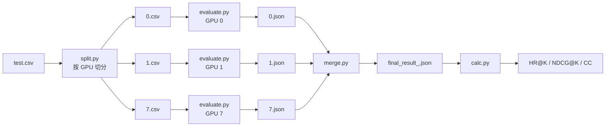

# 06 · 离线评估：约束解码、HR/NDCG 与 CC

| | |
|---|---|
| **读这篇前** | [05 RL](./05-rl.md)（约束解码在 RL 里也用） |
| **读完能回答** | 50 个 beam 怎么生成？为什么不会出现非法 item？HR/NDCG 的精确分母是什么？`CC` 为什么关键？ |
| **对应源码** | `evaluate.sh`、`split.py`、`evaluate.py`、`LogitProcessor.py`、`merge.py`、`calc.py` |
| **预计耗时** | 60 分钟 |

---

## 1. 评估流水线

`evaluate.sh` 做的事情：



特点：

- **每个 GPU 加载一份完整模型**，只做数据并行（按行切分），没有 tensor/pipeline parallel；
- 每个 shard 独立生成、独立写 JSON；
- `merge.py` 按 GPU 编号顺序拼接，保持原始行序；
- `calc.py` 统一算指标。

---

## 2. `evaluate.py` 的输入构造

### 2.1 读 info 文件

```python
semantic_ids = [line.split('\t')[0].strip() + "\n" for line in info]
item_titles  = [line.split('\t')[1].strip() + "\n" ...]

info_semantic = [f"### Response:\n{_}" for _ in semantic_ids]
info_titles   = [f"### Response:\n{_}" for _ in item_titles]
```

得到每个 item 的"SID + 换行"文本，用于构建前缀树。

### 2.2 数据集

`EvalSidDataset`（`data.py:597`）：

```text
Below is an instruction that describes a task, paired with an input that provides further context.
Write a response that appropriately completes the request.

### Instruction:
Can you predict the next possible item that the user may expect?

### User Input:
Can you predict the next possible item the user may expect, given the following
chronological interaction history: <a_..><b_..><c_..>, <a_..><b_..><c_..>

### Response:
```

注意这里的 prompt 与 SFT/RL 的模板并不完全一致（见 [05-rl.md](./05-rl.md) 的提示）。

---

## 3. 约束前缀树的构建

`evaluate.py:87`：

```python
hash_dict = {}
for ID in prefixID:                 # 每个 item 的 token id 序列
    ID.append(tokenizer.eos_token_id)
    for i in range(prefix_index, len(ID)):
        if i == prefix_index:
            key = get_hash(ID[:i])          # 包含 "### Response:\n"
        else:
            key = get_hash(ID[prefix_index:i])  # 只包含 SID 前缀
        hash_dict.setdefault(key, set()).add(ID[i])
```

用具体例子说明。假设：

```text
"### Response:\n" 的 token 是 [P0, P1, P2]
SID <a_42><b_80><c_160> 的 token 是 [S0, S1, S2]
EOS = E
```

则写入：

| key | 允许的下一个 token |
|---|---|
| `P0-P1-P2` | `S0` |
| `S0` | `S1` |
| `S0-S1` | `S2` |
| `S0-S1-S2` | `E` |

如果另一个 item 是 `<a_42><b_80><c_177>`，则 `S0-S1` 的集合里会同时有 `S2` 和 `S2'`。
解码时：

```text
count=0: key = prompt 最后 3 个 token = P0-P1-P2  -> 只能选 S0
count=1: key = 生成的第 1 个 token = S0          -> 只能选 S1
count=2: key = S0-S1                             -> 选 S2 或 S2'
count=3: key = S0-S1-S2                          -> 只能选 E
```

因此每个 beam 一定停在某个真实 item 的完整 SID 上。

> 这个结构等价于一棵 trie，但用"token 序列的字符串拼接"做 key，
> 实现简单，代价是每个 key 都要做一次字符串 join/查找。

#### 前提：`prefix_index` 和 BOS 必须对得上

上面的例子假设 `"### Response:\n"` 恰好是 3 个 token（`P0,P1,P2`）。
代码里用两个**硬编码的启发式**来凑这个假设：

```python
# evaluate.py:73 / minionerec_trainer.py:547
if base_model.lower().find("llama") > -1:
    prefixID = [tokenizer(_).input_ids[1:] for _ in info]   # 去掉 BOS
else:
    prefixID = [tokenizer(_).input_ids for _ in info]

prefix_index = 4 if base_model.lower().find("gpt2") > -1 else 3
```

| 启发式 | 目的 | 失效后果 |
|---|---|---|
| 路径含 `"llama"` → `[1:]` | LLaMA tokenizer 默认加 BOS，不去掉会让所有位置右移一位 | trie 的 key 与生成时对不上 → `allowed=[]` → 强制 EOS |
| 路径含 `"gpt2"` → `prefix_index=4` | GPT-2 的 BPE 把 `### Response:\n` 切成 4 个 token | 同上 |

**风险点**：判断依据是"模型路径字符串"，不是 tokenizer 本身的属性。
把 SFT 模型存到 `output_dir/exp1/final_checkpoint` 之后，路径里不再有 `"llama"`，
就会走错分支——而且**不会报错**，只会表现为"生成全是空/全是非法 SID、CC 飙升、reward 恒 0"。

更稳的写法（任选其一）：

```python
# 1) 直接让 tokenizer 别加特殊 token
prefixID = [tokenizer(s, add_special_tokens=False).input_ids for s in info]

# 2) 动态计算 marker 长度
marker_len = len(tokenizer("### Response:\n", add_special_tokens=False).input_ids)
prefix_index = marker_len
```

> 注意：`minionerec_trainer.py`、`evaluate.py`、`LogitProcessor.py` 三处都重复了这套判断，
> 改的话要一起改，否则训练和评估的 trie 结构会不一致。

---

## 4. 生成配置

`evaluate.py:170`：

```python
GenerationConfig(
    num_beams=50,
    num_return_sequences=50,
    length_penalty=0.0,
    max_new_tokens=256,
    do_sample=False,
)
```

然后在 `model.generate()` 里**再次显式传** `do_sample=False`：

```python
generation_output = model.generate(
    ...,
    generation_config=generation_config,
    do_sample=False,             # 必须作为 kwarg 传，见下方注释
    logits_processor=logits_processor,
)
```

源码注释解释了一个真实的坑：

> transformers ≥ 4.50 中，`generation_config` 里等于全局默认值的字段
> 会被模型自带的 `generation_config` 覆盖。Qwen2.5-Instruct 的 checkpoint
> 自带 `do_sample=true`，会导致"约束 beam search"退化成采样，
> 生成大量非法 SID。只有 `generate()` 的 kwargs 优先级高于模型默认值。

所以：**如果你看到 `CC` 很大，先检查 `do_sample` 是否真的为 False。**

---

## 5. 指标定义

### 5.1 命中位置

`calc.py`：

```python
for i, pred in enumerate(sample):     # 50 个候选，按 beam score 排序
    if pred == target_item:
        minID = i
        break
```

- `minID` 是第一个命中的位置（0-based）；
- 没命中时保持 `1000000`。

### 5.2 HR@K

$$
\mathrm{HR@K} = \frac{1}{N}\sum_{u=1}^{N} \mathbb{1}\left[\text{minID}_u < K\right]
$$

### 5.3 NDCG@K

因为每个样本只有一个相关 item，理想 DCG 为 1，所以：

$$
\mathrm{NDCG@K} = \frac{1}{N}\sum_{u=1}^{N}
\mathbb{1}\left[\text{minID}_u < K\right] \cdot
\frac{1}{\log_2(\text{minID}_u + 2)}
$$

- 位置 0：$1/\log_2 2 = 1$
- 位置 1：$1/\log_2 3 \approx 0.631$
- 位置 9：$1/\log_2 11 \approx 0.289$

代码里还除以了 $1/\log_2 2 = 1$，所以数值不变。

### 5.4 评估的 K

```python
topk_list = [1, 3, 5, 10, 20, 50]
```

只计算 $\le$ beam 数的 K。默认 50 beams，所以六个 K 都会输出。

### 5.5 CC 是什么

```python
if sample[i] not in item_dict:
    CC += 1
```

`CC` = **不在 info 文件里的预测数量**（逐候选计数）。
在约束解码正常工作时，它应该严格为 0。

- `CC > 0`：说明生成了非法 SID、tokenizer 不一致、或约束没生效；
- README 的公告也把它作为"constrained decoding 是否成功"的判据。

> 注意：CC 统计的是 50 个候选里的非法项，不是"样本数"。
> 50 个候选里只要有 1 个非法，CC 就 +1。

---

## 6. 评估结果 JSON 的结构

每个分片输出：

```json
[
  {
    "input": "...",
    "output": "<a_42><b_80><c_160>\n",
    "predict": [
      "<a_42><b_80><c_160>",
      "<a_42><b_80><c_177>",
      "... 共 50 个 ..."
    ]
  }
]
```

`merge.py` 只是把多个 list 拼接。`calc.py` 按 `output` 找 target，按 `predict` 顺序找第一个命中。

---

## 7. 一个完整的手算例子

假设某个样本：

```text
target = <a_42><b_80><c_160>
predict = [<a_42><b_80><c_177>, <a_42><b_80><c_160>, ...]
```

- `minID = 1`
- HR@1 = 0，HR@3 = 1
- NDCG@1 = 0，NDCG@3 = $1/\log_2 3 = 0.6309$
- NDCG@50 同样加 0.6309

如果该样本在 50 个候选里都没命中：

- 所有 HR = 0，所有 NDCG = 0。

---

## 8. 评估阶段的五个坑

| 坑 | 说明 | 排查 |
|---|---|---|
| `do_sample` 被 checkpoint 覆盖 | 约束 beam search 退化成采样，CC 飙升 | 显式传 `do_sample=False` kwarg |
| 模型没有 SID token | tokenizer 里没有 `<a_..>`，会被拆成多个 token | 用 SFT 保存的 `final_checkpoint`，不要用原始 base model |
| info 文件与 index 不一致 | trie 里的 SID 与实际 item 不匹配 | 用同一次 SID 构建产出的 `info.txt` |
| CC 突然很大、或全部候选只有 EOS | `base_model` 路径里**不含 "llama"**，但模型其实是 LLaMA 系 → 没去掉 BOS → trie 的 key 与生成时对不上 | 见下方"tokenizer 启发式"一节，改用动态计算 |
| `split.py` 多写索引列 | CSV 第一列变成 `Unnamed: 0` | 按列名读取，或改 `index=False` |
| 显存不够 | 50 beams × batch 8 × 长 prompt | 降 `--num_beams` 或 `--batch_size` |

另外两个"指标层面"的注意点：

1. **没有按用户去重**：测试集中同一用户可能有多个样本，指标是样本级平均；
2. **没有过滤"目标出现在历史里"的样本**：`dedup` 字段只用于构造，不在 `calc.py` 里过滤。
   如果数据里存在重复交互，指标会被高估。

---

## 9. 不跑模型也能验证指标代码

构造一个假的结果 JSON，直接跑 `calc.py`：

```bash
mkdir -p /tmp/minionerec-eval
python3 - <<'PY'
import json
rows = [
    {"output": "<a_1><b_1><c_1>\n",
     "predict": ["<a_9><b_9><c_9>", "<a_1><b_1><c_1>"] + ["<a_0><b_0><c_0>"]*8},
    {"output": "<a_2><b_2><c_2>\n",
     "predict": ["<a_2><b_2><c_2>"] + ["<a_0><b_0><c_0>"]*9},
]
json.dump(rows, open('/tmp/minionerec-eval/r.json', 'w'))
open('/tmp/minionerec-eval/info.txt','w').write(
    "<a_0><b_0><c_0>\tx0\t0\n"
    "<a_1><b_1><c_1>\tx1\t1\n"
    "<a_2><b_2><c_2>\tx2\t2\n")
PY

python3 calc.py --path /tmp/minionerec-eval/r.json \
                --item_path /tmp/minionerec-eval/info.txt
```

预期：

- 样本 1：minID=1 → HR@1=0, HR@3=1, NDCG@3≈0.631
- 样本 2：minID=0 → HR@1=1, NDCG@1=1
- 平均：HR@1=0.5, HR@3=1.0, NDCG@3≈0.815
- CC=0

（需要安装 `fire/pandas/numpy/tqdm`；没有环境时可直接阅读 `calc.py:12` 的循环。）

---

## 10. 下一步

主流程到这里闭环了。接下来看 GPR 变体：
[07-gpr.md](./07-gpr.md)；或者跳到 [08-code-map.md](./08-code-map.md) 做代码地图和练习。
