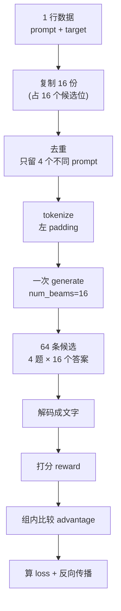

# 09 · RL 生成全过程（白话完整版）

| | |
|---|---|
| **读这篇前** | [04 SFT](./04-sft.md)；建议先读过 [05 RL](./05-rl.md) 的前两节 |
| **读完能回答** | 一条训练样本怎么变成 16 个候选？beam 排序、reward、advantage、loss 是按什么顺序算的？ |
| **对应源码** | `rl.py`、`minionerec_trainer.py`、`LogitProcessor.py` |
| **预计耗时** | 45 分钟 |

> 这一篇只讲一件事：**RL 阶段一条「结果」是怎么被生成出来的。**
> 从数据集里的一行，到模型吐出 16 个候选，再到 reward、advantage、loss。
> 尽量不用公式，需要精确时再给形状和代码位置。

---

## 0. 先给一张全景图



一句话：**模型一次写 16 份答案，不是写 16 次。**

---

## 1. 先设定一个具体场景

以 `rl.sh` 的默认配置、**单张卡上的一个 micro-batch** 为例：

| 名字 | 值 | 含义 |
|---|---|---|
| `B` | 64 | 这张卡这一批有 64 行（候选位） |
| `G` | 16 | 每道题要 16 个候选 |
| `B/G` | 4 | 这一批其实只有 4 道**不同**的题 |
| `P` | 例如 300 | prompt 的 token 长度（左 padding 后统一） |
| `C` | 5 | 每条答案生成的 token 数（3 个 SID + 换行 + 结束） |

---

## 2. 第 0 步：题目从哪来

`rl.py` 把三个数据集拼在一起当题库：

| 数据集 | 题目（prompt）长什么样 |
|---|---|
| `SidDataset` | 用户看过 `<a_12><b_7><c_3>, <a_9><b_201><c_44> …`，下一个是什么？ |
| `RLTitle2SidDataset` | 标题/描述是「Stanley 订书钉…」，它的 SID 是什么？ |
| `RLSeqTitle2SidDataset` | 标题序列是「A, B, C」，推荐下一个的 SID |

同时每个数据集还维护两个字典：

```python
prompt2history[prompt] = "历史字符串"
history2target[历史字符串] = "标准答案 SID"
```

这两个字典是给 reward 用的：拿到一条 prompt → 查历史 → 查标准答案 → 判断对错。

> 注意：数据集里的 `completion` 列在 RL 生成时**完全没用**。
> 模型只看 `prompt` 自己写，标准答案只用来打分。

---

## 3. 第 1 步：同一道题复制 16 份

`RepeatRandomSampler` 会让每个样本索引**连续出现 16 次**：

```text
样本编号： 0 0 0 … 0   1 1 1 … 1   2 2 …   3 3 …
共 64 行 = 4 道题 × 16 份
```

为什么复制？

因为后面的 reward 是**一行一行填**的，advantage 是**16 个一组算**的。
先开好 16 个格子，后面才有地方放 16 条候选的分数。

这不代表模型跑 16 次，只是**记账**。

---

## 4. 第 2 步：去重成 4 道题

真正送进模型前，代码只取每组的第 1 行：

```python
for i in range(len(prompt_ids)):
    if i % self.num_generations == 0:      # 0, 16, 32, 48
        dedup_prompt.append(prompt_ids[i])
```

于是 `(64, P)` 变成 `(4, P)`。

如果不去重、把 64 行都送进去，再让每行展开 16 个 beam，
就会算出 64×16 = 1024 条序列，其中绝大多数是同一道题的重复，白烧算力。

---

## 5. 第 3 步：变成 token（左 padding）

```python
prompt_inputs = tokenizer(prompts_text, padding=True, padding_side="left",
                          add_special_tokens=False)
prompt_ids  # (4, P)
prompt_mask # (4, P)
```

用左 padding 是因为自回归生成要从最后一个 token 往后接，
必须保证每条 prompt 的"结尾"对齐在最右边。

---

## 6. 第 4 步：准备一本"答题目录"

模型不能乱写，只允许写真实存在的商品。
这本目录在 `ReReTrainer.__init__` 里根据 `info_file` 建一次：

```text
info.txt 每一行： <a_42><b_80><c_160>\t商品标题\t123
```

把每行的 SID 拼到 `### Response:\n` 后面，做成一棵前缀树的查表：

| 已经写了什么 | 下一步只能写什么 |
|---|---|
| （还没写，prompt 以 `### Response:\n` 结尾） | 所有商品的第 1 层 token（`<a_42>`、`<a_236>` …） |
| `<a_42>` | 这个前缀下存在的第 2 层 token（`<b_80>`、`<b_194>` …） |
| `<a_42><b_80>` | 这个前缀下存在的第 3 层 token（`<c_160>`、`<c_177>`） |
| `<a_42><b_80><c_160>` | 换行符 `\n` |
| `<a_42><b_80><c_160>\n` | 结束符 EOS |

把它想成**输入法的联想**：你打了「a_42」，输入法只给你几个能接上的候选，
接不上的组合根本不显示。

---

## 7. 第 5 步：一次 generate 的完整 5 步

生成配置（`minionerec_trainer.py:482`）：

```python
GenerationConfig(
    num_beams=16,            # 16 条路并行
    num_return_sequences=16, # 全部返回
    do_sample=True,          # 每一步在候选里"抽"，不是死板取最高
    temperature=1.0,
    max_new_tokens=128,      # 只是上限，实际 5 步就结束
)
```

假设这一批只有 4 个商品（真实数据有几千个，这里为了看清逻辑）：

```text
1. <a_42><b_80><c_160>      ← 标准答案
2. <a_42><b_80><c_177>
3. <a_42><b_194><c_177>
4. <a_236><b_231><c_226>
```

模型为 **P1** 派出 16 条 beam，从同一个开头出发，一步一步写：

| 步 | 已经写了 | 目录允许写 | 结果 |
|---|---|---|---|
| 0 | `### Response:\n` | `<a_42>`、`<a_236>` | 16 条 beam 各自选中一个 |
| 1 | 例如都选了 `<a_42>` | `<b_80>`、`<b_194>` | 分叉 |
| 2 | 例如是 `<a_42><b_80>` | `<c_160>`、`<c_177>` | 分叉 |
| 3 | 完整 SID | 只有 `\n` | 统一补换行 |
| 4 | `…\n` | 只有 EOS | 全部停笔 |

要点：

- **16 条 beam 是同时在写的**，不是写完一条再写一条；
- "逐层"只是"逐 token 位置"的说法，第 1 个 token 就是第 1 层；
- 第 1 步选了什么，决定第 2 步能选什么（查目录时用的是**自己这条 beam 的前缀**）；
- 选"错"了不会退回去重写，它只是变成另一个合法商品的候选；
- 每写一步，非法 token 的分数都会被压成 `-inf`（`LogitProcessor.py`），想写也写不出来。

> 因为 `do_sample=True`，严格说这是 **beam sampling**：
> 每步把 16 条 beam 的所有合法 token 放进一个池子，按概率**不放回**抽 32 个组合，
> 再按累计分数保留最好的 16 条继续。
> 好处是 16 条答案有差异，但每条都还"靠谱"；
> 由于是不放回抽样 + 各 beam 前缀不同，16 条最终答案互不相同。

**一句话记住这个循环：**

> 每条 beam 用自己的前缀查出"下一层能写哪些 token" → 把「前缀 + 候选 token」拼成候选，
> 分数 = 前缀累计对数概率 + 当前 token 的对数概率 → 所有候选放进同一个池子，
> 按概率不放回抽 2G 个 → 统一排序，留前 G 个作为下一轮的 beam。

注意"抽 2G 个"不等于"每条 beam 各抽 2 个"，也不等于"抽完就是新 beam"：
抽取是在全局池子里进行的，抽完还要再筛一次（留前 G）。

---

## 8. 第 6 步：拿到 64 条答案

`generate` 一次返回 4 道题 × 16 条 = 64 条：

| 行号 | 内容 |
|---|---|
| 0–15 | P1 的 16 个候选 |
| 16–31 | P2 的 16 个候选 |
| 32–47 | P3 的 16 个候选 |
| 48–63 | P4 的 16 个候选 |

**组内按 beam 分数从高到低排列**（第 0 行是模型最看好的）。
这一点很重要：后面的排名惩罚就是按这个顺序给的。

裁掉 prompt 部分后：

```python
completion_ids   # (64, 5)
completion_mask  # (64, 5)，EOS 之后为 0
```

---

## 9. 第 7 步：把 token 变回文字

```python
completions_text = tokenizer.batch_decode(completion_ids, skip_special_tokens=True)
# ['<a_42><b_80><c_160>', '<a_42><b_80><c_177>', ...]
```

得到 64 个字符串，顺序与上面 64 行一一对应。

---

## 10. 第 8 步：让"参考模型"也算一遍概率

这一步不生成任何东西，只是把刚才这 64 条答案和 prompt 拼起来，
喂给 **SFT 时的旧模型**（ref model），算出它对每个答案 token 的 log 概率：

```python
ref_per_token_logps  # (64, 5)
```

它的作用是当"锚"：新模型不能为了拿高分跑得太偏（KL 约束）。
可以理解成"参考答案的思路"，用来限制改动幅度。

---

## 11. 第 9 步：打分（reward）

默认 `--reward_type ranking`，由两部分相加：

1. **对错分**：完全命中给 1，没命中给 0；
2. **排名分**：没命中的，按它在 16 条里的位置扣分，越靠前扣得越狠。

16 个位置的扣分权重（已归一化，总和为 1）：

| 位置（beam 排名） | 0 | 1 | 2 | 3 | … | 15 |
|---|---|---|---|---|---|---|
| 扣分 | -0.164 | -0.103 | -0.082 | -0.071 | … | -0.040 |

举例：假设 P1 的 16 条里，**第 4 条（下标 3）** 就是标准答案：

| 候选 | 对错分 | 排名分 | 最终 reward |
|---|---|---|---|
| 第 0 条（错的） | 0 | -0.164 | **-0.164** |
| 第 1 条（错的） | 0 | -0.103 | **-0.103** |
| 第 2 条（错的） | 0 | -0.082 | **-0.082** |
| 第 3 条（**答对**） | 1 | 0 | **1.000** |
| 第 4~15 条（错的） | 0 | -0.063 … -0.040 | **负分** |

如果 16 条**一条都没答对**：整组 reward 全部记 0（不惩罚也不奖励）。

---

## 12. 第 10 步：组内比较（advantage）

不直接拿 reward 去更新，而是问："跟同题的其他答案比，你好多少？"

$$
A_i = \frac{r_i - \text{组内均值}}{\text{组内标准差} + \epsilon}
$$

上例（答对在下标 3）算出来：

| 项 | 值 |
|---|---|
| 组内均值 | ≈ 0.0044 |
| 组内标准差 | ≈ 0.259 |
| 答对那条的 advantage | **≈ +3.84** |
| 最好的错误答案 | ≈ -0.17 |
| 最差的错误答案 | ≈ -0.65 |

含义：

- 答对的被**强烈拉高**；
- 所有错误答案都被**压低**，且"模型最看好却答错"的压得最狠；
- 如果整组全错，reward 全 0 → 均值 0、标准差 0 → advantage 全 0 → **这题这次不产生任何学习信号**。

---

## 13. 第 11 步：算 loss

把 64 条答案重新喂给**当前模型**，算它写这些 token 的概率 `per_token_logps (64,5)`，
然后：

```text
每个 token 的损失 = -（advantage × 该 token 的概率对数） + β × KL
每条答案的损失   = 5 个 token 求平均（EOS 之后 mask 掉）
整批的损失       = 64 条求平均
```

直觉：

- advantage 为正（答对）→ 提高这条答案的概率；
- advantage 为负（答错）→ 降低这条答案的概率；
- KL 项 → 别改得太狠，保持还会说人话。

`--dapo` / `--gspo` 只是把"怎么平均"换一种算法，其余不变。

---

## 14. 第 12 步：反向传播、更新参数

```text
loss.backward() → 更新 LLM 权重 → 下一步
```

参考模型的参数不动，只用来算 KL。

---

## 15. 顺便一提：训练中的"临时考试"

`--test_during_training True` 时，每隔一段会用另一套配置生成：

```python
test_generation_config = GenerationConfig(
    num_beams=20,        # 20 条
    do_sample=False,     # 不抽样，纯 beam search
)
```

然后把 20 条按顺序和标准答案比，直接算 HR@1/3/5/10/20 和 NDCG。
这只是训练时的监控指标，不参与梯度。

---

## 16. 最重要的一点：训练时的"结果" ≠ 对外的"推荐列表"

| | RL 训练时 | 离线评估时（`evaluate.py`） |
|---|---|---|
| 目的 | 造样本给模型学 | 产出给用户看的排序 |
| 配置 | `num_beams=16`，`do_sample=True` | `num_beams=50`，`do_sample=False` |
| 输出 | 16 个候选，顺序用于算 reward | 50 个候选，顺序就是排名 |
| 之后 | 算 advantage、更新参数 | 写 JSON → `calc.py` 算 HR/NDCG |

`calc.py` 拿到 50 条后，找标准答案第一次出现的位置 `minID`：
位置越靠前，HR/NDCG 越高；找不到就是 0。

---

## 17. 常见误解对照表

| 误解 | 实际 |
|---|---|
| 重复 16 次 = 推理 16 次 | 是占 16 个记账槽位，推理只有一次 |
| 先采样第 1 层，再重新采样第 2 层 | 16 条 beam 在同一次生成里一起往下写 |
| 写错一层要退回去重写 | 不退，只是变成另一个合法商品 |
| 生成数量不够会循环重试 | 数量由 `num_generations` 固定；只有显式开 `dynamic_sampling` 才多生成再筛 |
| `max_new_tokens=128` 会生成 128 个 token | 写完 SID + 换行 + EOS 就停，实际约 5 个 |
| 16 条候选一定互不相同 | 约束只保证"合法"，不保证"不重复" |
| 训练时生成的 16 条就是最终推荐 | 最终推荐由评估阶段的 50 条 beam 决定 |

---

## 18. 一页速查

```text
1 道题
  → 复制 16 份（记账）
  → 去重成 1 份送模型
  → 一次 generate（16 beams，约束解码，5 步）
  → 16 条完整 SID
  → 解码成文字
  → 参考模型算 logp
  → reward（命中 1 分 + 排名扣分）
  → 组内归一化 advantage
  → loss（policy + KL）
  → 反向传播
```

对应代码：

| 步骤 | 位置 |
|---|---|
| 复制 16 份 | `minionerec_trainer.py:80`（`RepeatRandomSampler`） |
| 去重 | `minionerec_trainer.py:780` |
| 生成配置 | `minionerec_trainer.py:482` |
| 目录树 | `minionerec_trainer.py:557` |
| 约束 mask | `LogitProcessor.py:45` |
| reward | `rl.py:186` 起 |
| advantage | `minionerec_trainer.py:966` |
| loss | `minionerec_trainer.py:1035` |

---

## 相关章节

| 想做的事 | 去哪 |
|---|---|
| 把这条链路真的跑一遍（参数、显存、排错） | [11 实操手册](./11-hands-on.md) |
| 看 GRPO 的公式与张量推导 | [05 RL](./05-rl.md) |
| 换一套 SID 后哪些东西会变 | [10 §7](./10-sid-generators.md) |
