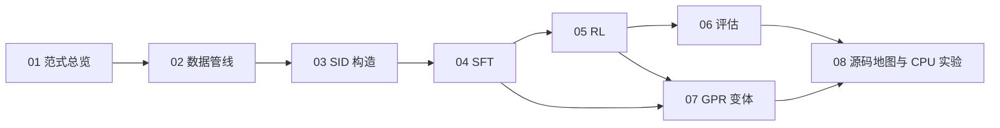
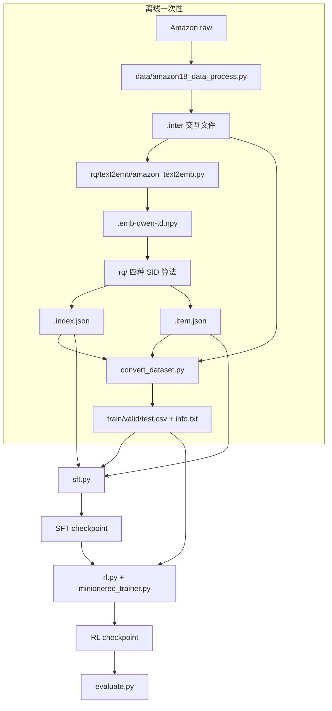

# MiniOneRec 源码精读手册

> 面向「懂 Python 和推荐系统、但没做过 LLM 训练」的读者。
> 目标不是复现 SOTA，而是把 **生成式推荐（Generative Recommendation, GR）** 这套范式、
> 以及 MiniOneRec 里每一行关键代码的输入输出、张量形状、损失函数讲清楚。

---

## 0. 这套文档怎么用

MiniOneRec 的代码是"研究代码"风格：一个 `data.py` 里堆了十几个 Dataset，训练脚本里同时开了
多条消融分支，默认超参也偏工程化。**不要从头到尾按文件读**。推荐顺序：



| 文档 | 回答的问题 | 对应源码 |
|---|---|---|
| [01-paradigm.md](./01-paradigm.md) | 生成式推荐到底在生成什么？为什么要把 item 变成 SID？ | 全仓库 |
| [02-data-pipeline.md](./02-data-pipeline.md) | 原始 Amazon 数据怎么变成 `.inter` / `.csv` / `.item.json`？字段长什么样？ | `data/`, `rq/text2emb/`, `convert_dataset.py` |
| [03-sid-construction.md](./03-sid-construction.md) | RQ-VAE / RQ-KMeans / constrained / RQ-KMeans+ 的公式、张量、冲突率 | `rq/` |
| [04-sft.md](./04-sft.md) | 一条样本如何变成 `input_ids/labels`？新词表、冻结 LLM、三种辅助任务 | `sft.py`, `data.py` |
| [05-rl.md](./05-rl.md) | GRPO 的组内归一化、约束 beam search、reward、DAPO/GSPO 损失 | `rl.py`, `minionerec_trainer.py` |
| [06-evaluation.md](./06-evaluation.md) | 约束解码的 trie 怎么建？HR/NDCG 怎么算？CC 是什么？ | `evaluate.py`, `LogitProcessor.py`, `calc.py` |
| [07-gpr.md](./07-gpr.md) | GPR 变体的 U/E/I/O token、VAFT、HEPO 与主流程的差异 | `*_gpr.py`, `data.py` 的 GPR 数据集 |
| [08-code-map.md](./08-code-map.md) | 所有关键函数的地图、按调用链阅读顺序、CPU 上能做的练习、常见坑 | 全仓库 |
| [09-rl-generation-walkthrough.md](./09-rl-generation-walkthrough.md) | 白话完整版：一条结果从数据行到 16 个候选、reward、advantage、loss 的全过程 | `rl.py`, `minionerec_trainer.py` |

> 建议第一遍只读 01 → 02 → 03 → 04 → 05 → 06，跳过所有 `*_gpr.py`；
> 第二遍再读 07，并回到 04/05 对照差异。

### 建议学习节奏（按每天 1–2 小时）

| 天 | 内容 | 产出 |
|---|---|---|
| 1 | 01 + 02 | 画出自己的数据流图；说清 `.npy/.item.json/.index.json/.inter` 的对齐关系 |
| 2 | 03 | 手写一遍残差量化；检查自带数据的冲突率与各层 token 分布 |
| 3 | 04 | 手工构造一条 SFT 样本，数清监督 token；理解 `-100` 与左截断 |
| 4 | 05（上） | 理解 GRPO 组内归一化；手算 advantage 与 rank reward |
| 5 | 05（下）+ 06 | 说清约束 trie 的构建与 HR/NDCG/CC 的定义 |
| 6 | 08 | 做 4 个 CPU 实验；按调用链在代码里打断点 |
| 7 | 07 | 只读 GPR 的差异部分，列出"设计意图 vs 实际接线" |

如果时间有限，至少完成第 2、3、5 天的三个实验——它们最能建立"数据长什么样"的直觉。

---

## 1. 一句话理解 MiniOneRec

把每个商品压缩成 3 个离散 token（例如 `<a_42><b_80><c_160>`），
把用户历史写成这些 token 的序列，然后让一个 LLM 做 **next-token prediction**；
SFT 学会"照着 SID 续写"，RL 用推荐指标（命中/排名）继续优化。


它和"传统序列推荐（SASRec/HGN）"最大的区别：

| 维度 | 传统序列推荐 | MiniOneRec |
|---|---|---|
| item 表示 | 随机初始化的 ID embedding | 由文本语义量化得到的离散 SID |
| 打分方式 | 内积 / softmax over item 集合 | 自回归生成 token，再按 SID 查 item |
| 冷启动 | 新 item 没有 embedding | 新 item 只要有标题/描述就能算 SID |
| 世界知识 | 无 | 继承 LLM 的语言知识（SFT 中用对齐任务强化） |
| 输出空间 | 全库 softmax | 受约束的 SID 前缀树（保证生成合法 item） |

---

## 2. 仓库的三个"入口"

先记住这三条命令，后面所有代码都是为它们服务的：

```bash
# 1) SFT：把 (历史 SID -> 下一个 SID) 灌进 LLM
bash sft.sh

# 2) RL：从 SFT checkpoint 出发，用推荐 reward 做 GRPO
bash rl.sh

# 3) 评估：约束 beam search + HR/NDCG
bash evaluate.sh
```

它们之间的依赖关系：



---

## 3. 先建立三个"数量级"直觉

以仓库自带的 `Industrial_and_Scientific` 为例（不同版本数字略有差异）：

| 量 | 典型值 | 在哪里体现 |
|---|---|---|
| item 数 | 仓库自带样例 3,686 | `.index.json` 的 key 数 |
| SID 层数 | 3 | `<a_*><b_*><c_*>` |
| 每层码本大小 | 256 | `--num_emb_list 256 256 256` |
| 文本 embedding 维度 | 2560（Qwen2.5-3B hidden） | `.npy` 的列数 |
| 历史长度 | 滑动窗口最多 10 条 | `data/amazon18_data_process.py` 的 `st = max(i - 10, 0)` |
| SFT 全局 batch | 1024（8 卡 × micro 16 × accum 8） | `sft.sh` |
| RL 每个 prompt 采样数 | 16 | `--num_generations 16` |
| 评估 beam 数 | 50 | `--num_beams 50` |

> 注意：SID 的层数、码本大小、embedding 维度是三个独立的超参，
> 不要把它们和 LLM 的 hidden size 混在一起。

---

## 4. 读代码时的三个"防迷路"原则

1. **先看数据，再看模型。** 每个 Dataset 的 `get_history()` 决定 prompt 长什么样，
   `pre()` 决定 label 长什么样。模型只是标准的 causal LM。
2. **看到 `eval()` 不要慌。** `data.py` 里大量 `eval(row['history_item_sid'])` 只是为了
   把 CSV 里存成字符串的 list 还原成 list，不是模型评估。
3. **看到 `*_gpr.py` 先放一边。** 它们是另一篇论文的变体，主流程不依赖。

---

## 5. 文档约定

- 公式里的记号：
  - $x \in \mathbb{R}^{d}$：item 的文本 embedding
  - $K$：每层码本大小，$L$：层数
  - $e_k^{(l)}$：第 $l$ 层第 $k$ 个码本向量
  - $c_i = (c_i^{(1)}, \dots, c_i^{(L)})$：item $i$ 的 SID
- 行号引用格式：`data.py:403` 表示当前 commit 下的行号，重构后可能漂移，
  以函数名为准。
- 所有命令默认在仓库根目录执行。

---

## 6. 版本说明

这套文档是学习笔记，已随 fork `Yufan0406/MiniOneRec-learning` 提交，内容对应上游
[`AkaliKong/MiniOneRec`](https://github.com/AkaliKong/MiniOneRec) `main` 的
`5263062`（Merge PR #84，新增 FLASH-SimHash、PRQ-KMeans、RQ-OPQ 三种 SID 构造）。

同步上游：

```bash
git fetch upstream
git checkout main && git merge --ff-only upstream/main && git push origin main
git checkout learning-notes && git rebase main   # 笔记分支跟着前移
```

上游新增的 `rq/generate_indices_flash.py`、`sid_generation/` 尚未写入 03 章；
读 SID 构造时以 03 章的 RQ-VAE / RQ-KMeans / RQ-KMeans+ 为主线即可。
