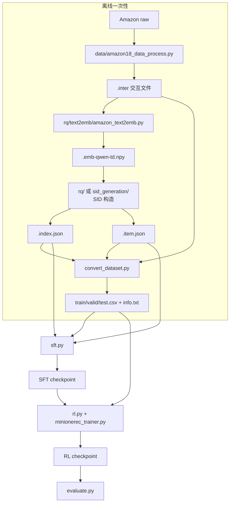

# MiniOneRec 源码精读手册

> 面向「懂 Python 和推荐系统、但没做过 LLM 训练」的读者。
> 目标不是复现 SOTA，而是把 **生成式推荐（Generative Recommendation, GR）** 这套范式、
> 以及 MiniOneRec 里关键代码的输入输出、张量形状、损失函数讲清楚。

---

## 0. 三条使用路径

先想清楚你现在要干什么，再决定读哪几章——**不要从头按文件顺序读源码**。

| 路径 | 你想达到的效果 | 章节顺序 | 累计时间 |
|---|---|---|---|
| **A · 入门** | 能画数据流、说清"一条样本怎么变成一次梯度更新" | 01 → 02 → 03 → 04 → 05 → 06 | 约 7 小时 |
| **B · 深化** | 搞懂论文变体、新算法、以及"为什么这么设计" | 07 / 09 / 10（按需挑）+ 08 工具页 | 每章 45–90 分钟 |
| **C · 实操** | 在自有硬件上真的跑起来，并知道报错该看哪 | 11 → 10 的第 8 节 → 03 §7 / 08 §4 | 30 分钟起 |

```mermaid
flowchart TB
    subgraph A[路径 A · 入门]
        direction LR
        A1[01 范式] --> A2[02 数据] --> A3[03 SID] --> A4[04 SFT] --> A5[05 RL] --> A6[06 评估]
    end
    subgraph C[路径 C · 实操]
        direction LR
        C1[11 实操手册] --> C2[10 新 SID 生成器]
    end
    subgraph B[路径 B · 深化]
        direction LR
        B1[07 GPR 变体]
        B2[09 RL 白话全过程]
        B3[08 源码地图 / 术语 / FAQ]
    end
    A3 -.同主题扩展.-> C2
    A3 --> B1
    A5 --> B2
    A6 --> B3
```



**只有 30 分钟？** 读 01 的第 1、3 节 → 03 的第 4 节（token 命名与 0/1-based）→ 05 的第 1 节（为什么 SFT 不够），
然后看 11 的"命令速查卡"。

---

## 1. 章节地图

| 章节 | 回答什么问题 | 对应源码 | 难度 | 耗时 | 前置 |
|---|---|---|---|---|---|
| [01 范式](./01-paradigm.md) | 生成式推荐到底在生成什么？为什么要把 item 变成 SID？ | 全仓库 | ★☆☆☆☆ | 30 min | — |
| [02 数据管线](./02-data-pipeline.md) | 原始数据怎么变成 `.inter` / `.npy` / `.item.json` / `.index.json` / `.csv`？字段下标指向谁？ | `data/`、`rq/text2emb/`、`convert_dataset.py` | ★★☆☆☆ | 60 min | 01 |
| [03 SID 构建](./03-sid-construction.md) | RQ-VAE / RQ-KMeans / constrained / RQ-KMeans+ 的公式、张量、冲突率 | `rq/` | ★★★☆☆ | 90 min | 02 |
| [04 SFT](./04-sft.md) | 一条样本如何变成 `input_ids/labels`？新词表、冻结 LLM、三种辅助任务 | `sft.py`、`data.py` | ★★★☆☆ | 60 min | 03 |
| [05 RL](./05-rl.md) | GRPO 的组内归一化、约束 beam search、reward、DAPO/GSPO 损失 | `rl.py`、`minionerec_trainer.py`、`LogitProcessor.py` | ★★★★☆ | 120 min | 04 |
| [06 评估](./06-evaluation.md) | 约束解码的 trie 怎么建？HR/NDCG 怎么算？`CC` 是什么？ | `evaluate.py`、`LogitProcessor.py`、`calc.py` | ★★★☆☆ | 60 min | 05 |
| [07 GPR 变体](./07-gpr.md) | U/E/I/O token、VAFT、HEPO 与主流程差在哪？哪些接上了、哪些没接？ | `*_gpr.py`、`data.py` 的 GPR 数据集 | ★★★★☆ | 45 min | 04、05 |
| [08 源码地图](./08-code-map.md) | 文件/函数地图、按调用链阅读顺序、CPU 小实验、FAQ、术语表 | 全仓库 | ★★☆☆☆ | 30 min（可随时查） | 02 |
| [09 RL 生成全过程](./09-rl-generation-walkthrough.md) | 白话版：一条结果从数据行 → 16 个候选 → reward → advantage → loss | `rl.py`、`minionerec_trainer.py` | ★★★☆☆ | 45 min | 04、05 |
| [10 新 SID 构造](./10-sid-generators.md) | FLASH-SimHash / PRQ-KMeans / RQ-OPQ 怎么工作？身份 token 是什么？换 SID 会波及什么？ | `rq/flash_sid/`、`sid_generation/` | ★★★☆☆ | 75 min | 03 |
| [11 实操手册](./11-hands-on.md) | 自己的机器上怎么跑通？参数怎么改？报错先看哪里？ | 各 `*.sh`、`convert_dataset.py` | ★★☆☆☆ | 30 min 起 | 02 |

> 章号只表示**写作顺序**，不表示必须按顺序读。每个文件开头都有导航表（前置 / 产出 / 耗时），
> 从任意一章进来都能判断要不要往回翻。

---

## 2. 建议学习节奏（每天 1–2 小时）

| 天 | 内容 | 产出（自检） |
|---|---|---|
| 1 | 01 + 02 | 画出自己的数据流图；说清 `.npy/.item.json/.index.json/.csv` 的对齐关系 |
| 2 | 03 | 手写一遍残差量化；用自带 index 统计冲突率与各层 token 分布 |
| 3 | 04 | 手工构造一条 SFT 样本，数清被监督的 token；理解 `-100` 与左截断 |
| 4 | 05（上） | 理解 GRPO 组内归一化；手算 advantage 与 rank reward |
| 5 | 05（下）+ 06 | 说清约束 trie 的构建与 HR/NDCG/CC 的定义 |
| 6 | 10 或 11 | 用 FLASH 或 PRQ 重新生成一套 SID，对比冲突率 |
| 7 | 07 + 08 | 只读 GPR 的差异；把 4 个 CPU 实验做完 |

时间有限时，至少完成第 2、3、6 天——它们最能建立"数据到底长什么样"的直觉。

---

## 3. 一句话理解 MiniOneRec

把每个商品压缩成 3 个离散 token（例如 `<a_42><b_80><c_160>`），
把用户历史写成这些 token 的序列，然后让一个 LLM 做 **next-token prediction**；
SFT 学会"照着 SID 续写"，RL 用推荐指标（命中/排名）继续优化。


它和"传统序列推荐（SASRec/HGN）"最大的区别：

| 维度 | 传统序列推荐 | MiniOneRec |
|---|---|---|
| item 表示 | 随机初始化的 ID embedding | 由文本语义量化得到的离散 SID |
| 打分方式 | 内积 / softmax over item 集合 | 自回归生成 token，再按 SID 查 item |
| 冷启动 | 新 item 没有 embedding | 新 item 只要有标题/描述就能算 SID |
| 世界知识 | 无 | 继承 LLM 的语言知识（SFT 中用对齐任务强化） |
| 输出空间 | 全库 softmax | 受约束的 SID 前缀树（保证生成合法 item） |

---

## 4. 三条"入口"命令

仓库里几乎所有代码都是为这三条命令服务的：

```bash
bash sft.sh        # SFT：把 (历史 SID -> 下一个 SID) 灌进 LLM
bash rl.sh         # RL：从 SFT checkpoint 出发，用推荐 reward 做 GRPO
bash evaluate.sh   # 评估：约束 beam search + HR/NDCG
```

依赖关系：



---

## 5. 先建立三个"数量级"直觉

以仓库自带的 `Industrial_and_Scientific` 为例（实测，不同版本略有差异）：

| 量 | 典型值 | 在哪里体现 |
|---|---|---|
| item 数 | 3,686 | `.index.json` 的 key 数、`info.txt` 的行数 |
| SID 语义层数 | 3（`<a_*><b_*><c_*>`） | 03 章的 $L$ |
| SID 实际长度 | **3 ~ 6 都可能** | 追加身份 token 后会变长（见 10 章 §6），代码统一用 `''.join(sids)` |
| 每层码本大小 | 256 | `--num_emb_list 256 256 256` |
| 文本 embedding 维度 | 2,560（Qwen2.5-3B hidden） | `.npy` 的列数 |
| 训练 / 验证 / 测试样本 | 36,259 / 4,532 / 4,533 | CSV 行数（不含表头） |
| 历史长度 | 滑动窗口最多 10 条 | `data/amazon18_data_process.py` 的 `st = max(i - 10, 0)` |
| SFT 全局 batch | 8 卡 × micro 16 × accum 64 = 8,192 | 见 11 章 §7（`--batch_size` 不是全局 batch） |
| RL 每个 prompt 采样数 | 16 | `--num_generations 16` |
| 评估 beam 数 | 50 | `--num_beams 50` |

> SID 层数、码本大小、embedding 维度是三个**独立**的超参，别和 LLM 的 hidden size 混在一起。

---

## 6. 读代码时的三个"防迷路"原则

1. **先看数据，再看模型。** 每个 Dataset 的 `get_history()` 决定 prompt 长什么样，
   `pre()` 决定 label 长什么样。模型只是标准的 causal LM。
2. **看到 `eval()` 不要慌。** `data.py` 里大量 `eval(row['history_item_sid'])` 只是把
   CSV 里存成字符串的 list 还原成 list，不是模型评估。
3. **看到 `*_gpr.py` 先放一边。** 它们是另一篇论文的变体，主流程不依赖。

---

## 7. 文档约定

- 公式里的记号：
  - $x \in \mathbb{R}^{d}$：item 的文本 embedding
  - $K$：每层码本大小，$L$：层数
  - $e_k^{(l)}$：第 $l$ 层第 $k$ 个码本向量
  - $c_i = (c_i^{(1)}, \dots, c_i^{(L)})$：item $i$ 的 SID
- 行号引用格式：`data.py:403` 表示当前 commit 下的行号，重构后可能漂移，
  **以函数名为准**。
- 所有命令默认在仓库根目录执行。
- 实测数字都标注了环境（例如"Mac CPU，3,686 items"）；没有实测的会明确写出来。

---

## 8. 版本说明

这套文档是学习笔记，随 fork [`Yufan0406/MiniOneRec-learning`](https://github.com/Yufan0406/MiniOneRec-learning)
提交，内容对应上游 [`AkaliKong/MiniOneRec`](https://github.com/AkaliKong/MiniOneRec) `main` 的
`5263062`（PR #83 新增 FLASH-SimHash；PR #84 新增 PRQ-KMeans 与 RQ-OPQ，并修正 SID 全量拼接）。

同步上游：

```bash
git fetch upstream
git checkout main && git merge --ff-only upstream/main && git push origin main
```

上游改动对笔记的影响记录在 [10 章 §7](./10-sid-generators.md)，要点：

| 上游改动 | 影响的章节 |
|---|---|
| `data.py` / `ts_rec_data.py` 改成 `''.join(sids)` | 04 §3.1、§8.1（原来描述"只取前三层"） |
| `minionerec_trainer.py` 测试用独立 `ConstrainedLogitsProcessor` | 05 §5、06 §2（`count` 是实例状态） |
| 新增 `rq/flash_sid/`、`sid_generation/`、`tests/test_flash_sid*` | 新增 10 章；08 的文件地图 |
